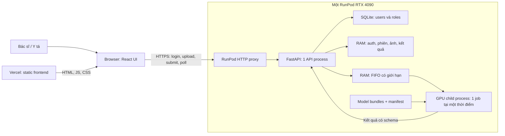
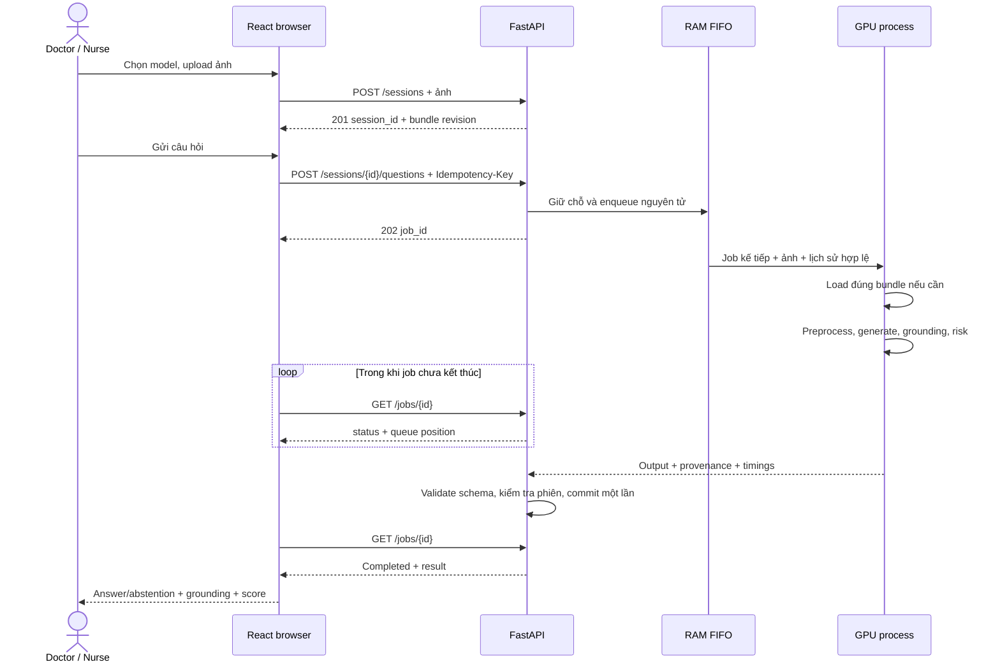
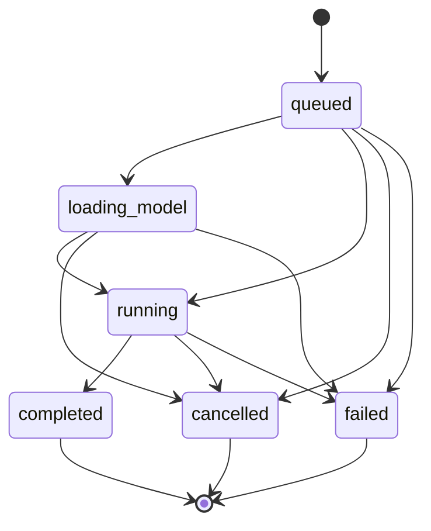

# Kế hoạch thiết kế hệ thống hỗ trợ diễn giải X-quang ngực

Ngày: 14/10/2026. Trạng thái: bản thiết kế để team review, chưa triển khai.

Tài liệu thiết kế luồng end-to-end từ model đã fine-tune đến giao diện hỗ trợ bác sĩ và y tá hỏi đáp về ảnh chest X-ray. Đầu ra hiện tại là demo Capstone A cho supervisor. Kiến trúc lấy bối cảnh hỗ trợ quyết định lâm sàng, còn việc đưa vào bệnh viện thực tế cần một giai đoạn đánh giá và tích hợp riêng.

## 1. Hợp đồng công việc và nguồn yêu cầu

| Mục | Nội dung |
|---|---|
| Jira liên quan | [SCRUM-14: chest X-ray VQA MVP](https://vlminmedical.atlassian.net/browse/SCRUM-14); liên quan SCRUM-13, MVD-5, MVD-8 |
| Mục tiêu lượt này | Tạo plan hệ thống có thể chia thành các task triển khai |
| Phạm vi thay đổi | Chỉ thêm `SYSTEM_DESIGN_PLAN.md` |
| Đầu vào | Các quyết định người dùng đã xác nhận; `AGENTS-INSTRUCTIONS.md`; `DETAILED_ACTION_PLAN.md`; SCRUM-14; `docker/README.md`; `CI-CD.md` |
| Đầu ra | Kiến trúc, luồng xử lý, hợp đồng model/API, vòng đời dữ liệu, deployment, test và kế hoạch theo deadline |
| Ngoài phạm vi lượt này | Viết ứng dụng, fine-tuning, chọn backbone, đổi calibration, triển khai cloud, thuê GPU, sửa Jira hoặc commit |
| Kiểm tra | Đối chiếu yêu cầu, review độc lập các failure case, kiểm tra tài liệu và các kiểm tra repo được policy yêu cầu |
| Ngân sách | Chỉ đọc và viết tài liệu, không có GPU run hoặc dịch vụ trả phí được tạo |
| Điểm phải dừng khi triển khai | Model/data chưa có quyền sử dụng; GPU preflight fail; pipeline không đạt hợp đồng; chi phí chưa được duyệt |
| Review con người | Đức Anh: model/integration; Gia Khánh: reliability labels; Cáp: demo-data provenance; chưa đánh dấu ai đã review |
| Chế độ thực hiện | Main agent ghi tài liệu; một subagent read-only review lifecycle, queue và privacy, dùng model/effort kế thừa; không có worktree riêng |
| External research | Tài liệu chính thức RunPod, Vercel, FastAPI, SQLite và OWASP, đối chiếu ngày 14/10/2026 |

Các quyết định của người dùng được ghi lại ở đây để team sử dụng khi triển khai. Tài liệu này không thay đổi baseline, experiment protocol hoặc trạng thái Jira. Deadline và tiêu chí app tiếp tục bám `DETAILED_ACTION_PLAN.md` cùng SCRUM-14.

## 2. Phạm vi đã chốt

| Chủ đề | Quyết định |
|---|---|
| Người dùng | Bác sĩ và y tá; mỗi tài khoản có `user_id`; cả hai có cùng quyền upload, chọn model, hỏi đáp trong demo |
| Account | Tạo sẵn tài khoản demo; lưu thông tin đăng nhập và role; không mở đăng ký công khai |
| Model | Giả định team có model sẵn để bàn giao; danh sách và kích thước chưa xác định; người dùng chọn một model cho mỗi phiên |
| Đầu vào | Một ảnh PNG/JPG và câu hỏi tiếng Anh; hỗ trợ hỏi độc lập hoặc hỏi tiếp nhiều lượt trên cùng ảnh |
| Đầu ra | Answer, grounding/status, confidence hoặc risk, threshold, abstention, model revision và thời gian xử lý |
| Frontend | React, deploy Vercel |
| Backend | FastAPI trên một RunPod GPU Pod, truy cập qua Internet |
| GPU | RTX 4090 làm profile demo chính. RTX 3090 là phương án dự phòng cần bổ sung kiểm chứng và policy trước khi sử dụng |
| Quy mô | Khoảng 5 người dùng đồng thời; chưa đặt SLA latency |
| Lưu trữ nội dung | Chỉ tạm thời trong phiên; không có lịch sử lâu dài, kho ảnh hoặc hồ sơ bệnh nhân |
| Dữ liệu demo | Ảnh chest X-ray ngoài MIMIC, có quyền sử dụng và trình chiếu; câu hỏi tự viết theo cấu trúc template, không sao chép nội dung hàng dữ liệu MIMIC |
| Tích hợp bệnh viện | Demo upload thủ công; chưa kết nối PACS/RIS/HIS, DICOM hoặc cơ chế ký kết luận |
| Mốc giao | Review baseline 15/11; MVP beta 29/11; demo và giao bài 06/12/2026 |

Ảnh và hội thoại không được lưu lâu dài, nhưng account database, model artifacts và cấu hình triển khai cần tồn tại qua restart. Đây là ba loại dữ liệu khác nhau trong thiết kế.

## 3. Kiến trúc được đề xuất

Một ứng dụng backend chia module, chạy trong một Pod. Một API process điều phối các phiên và một GPU child process thực hiện load/inference. Không cần broker hoặc database hội thoại cho quy mô demo này.

Trình duyệt gửi ảnh và câu hỏi trực tiếp tới RunPod bằng HTTPS. Vercel chỉ phục vụ frontend; không đưa upload/inference qua Vercel Functions. Cách này tránh một tầng chuyển tiếp payload và giới hạn payload của Functions. [Vercel Functions limits](https://vercel.com/docs/functions/limitations).

Backend trả `202 Accepted` với `job_id` sau khi nhận câu hỏi hợp lệ. Frontend gọi API trạng thái cho đến khi có kết quả. RunPod hiện mô tả HTTP proxy có timeout 100 giây; vì vậy plan không giữ một request mở trong suốt thời gian inference. [RunPod expose ports](https://docs.runpod.io/pods/configuration/expose-ports).

### 3.1 Trách nhiệm các thành phần

| Thành phần | Trách nhiệm |
|---|---|
| React UI | Đăng nhập, chọn model, xem ảnh tạm, hỏi đáp, polling, hiển thị grounding và trạng thái |
| API/auth | Xác thực account, kiểm tra owner, validate input, giới hạn request, trả lỗi ổn định |
| Session store | Giữ ảnh và lịch sử có thẩm quyền ở server; theo dõi TTL, model revision và lượt hỏi |
| Job coordinator | Admission, FIFO, idempotency, cancel, timeout, commit kết quả, giám sát GPU process |
| Model catalog | Manifest các bundle được team duyệt, capabilities và trạng thái có thể chọn |
| GPU process | Load/unload bundle, preprocessing theo bundle, inference, grounding/risk, validate output cơ bản |
| Account database | Account ID, username, password hash, role, active flag; không có nội dung ảnh/chat |

API chạy một Uvicorn worker. Nhiều worker sẽ tạo nhiều bản state trong RAM và có thể nhân bản model/process. FastAPI lưu ý mỗi process thường có bộ nhớ riêng. [FastAPI deployment concepts](https://fastapi.tiangolo.com/deployment/concepts/).

GPU child process được tạo theo chế độ `spawn`; CUDA chỉ được khởi tạo trong child. API process không load model. IPC chỉ mang payload của job đang chạy và kết quả tương ứng, có `job_id` cùng worker generation để loại kết quả cũ.

### 3.2 So sánh các lựa chọn

| Lựa chọn | Quyết định và lý do |
|---|---|
| FastAPI xử lý inference đồng bộ trong HTTP request | Không chọn vì request có thể vượt timeout proxy và chặn các tác vụ khác |
| Một process với inference thread | Ít thành phần hơn nhưng khó dừng inference bị treo mà vẫn giữ API và queue |
| API process + một GPU child process + RAM queue | Chọn cho demo; có thể restart GPU process khi lỗi mà giữ queue của những người còn lại |
| Redis/Celery, nhiều inference replicas | Để sau khi cần job bền vững qua restart, nhiều GPU hoặc nhiều API workers |
| RunPod Serverless | Chưa chọn vì thiết kế hiện cần Pod có trạng thái phiên và model residency do ứng dụng kiểm soát |

Một Pod vẫn là điểm lỗi duy nhất. Demo chấp nhận mất phiên khi API/Pod restart; không mô tả hệ thống là high availability.

## 4. Luồng người dùng và màn hình

### 4.1 Màn hình đăng nhập

Username và password; hiển thị lỗi đăng nhập chung, không tiết lộ tài khoản nào tồn tại. Sau khi đăng nhập, header hiện tên, vai trò và thao tác logout. `user_id` dùng làm định danh account ở backend, có thể xem trong phần thông tin tài khoản.

### 4.2 Workspace hỗ trợ diễn giải

- Chọn model trong danh sách bundle đã sẵn sàng. Hiển thị phiên bản và trạng thái đang nạp nếu cần.
- Upload một ảnh chest X-ray; xem ảnh và bật/tắt overlay grounding của lượt trả lời đang chọn.
- Ô hỏi tiếng Anh kèm một số câu hỏi mẫu tự viết, cho phép sửa nội dung trước khi gửi.
- Vùng hội thoại hiện câu hỏi, answer hoặc abstention, và trạng thái `Queued`, `Loading model`, `Analyzing`, `Completed`, `Failed`.
- Panel kết quả hiện numerical score, ý nghĩa score, threshold, calibration applicability, grounding method/validation status, model revision và thời gian xử lý.
- Có `Cancel`, `Clear conversation`, `New image`, `Change model` và `End session`. Không có patient list, archive, report signing hoặc export trong MVP.

Chưa cần token streaming. UI nhận câu trả lời đầy đủ sau khi pipeline hoàn tất grounding và quyết định abstain; tránh hiển thị một câu trả lời rồi rút lại khi risk stage hoàn tất.

### 4.3 Quy tắc phiên

Một phiên gắn với đúng một owner, một ảnh và một bundle revision. Mỗi lượt hỏi thành công tạo một cặp question/result trong lịch sử server. Lượt thất bại hoặc bị hủy không trở thành ngữ cảnh cho lượt sau.

Hỏi tiếp dùng lịch sử của phiên. `Clear conversation` giữ ảnh và model, xóa lịch sử và tạo context revision mới. Đổi ảnh hoặc model đóng phiên cũ và tạo phiên mới. Khi đang có job, API trả conflict cho thao tác reset/đổi; UI yêu cầu hủy job trước. `End session` và logout có quyền hủy job và đóng phiên ngay.

Frontend không gửi system prompt, role của message hay lịch sử assistant tự dựng. Backend lấy lịch sử đã xác nhận từ RAM và dùng chat template được bàn giao. Không dùng chung KV cache hoặc hội thoại giữa hai user.

## 5. Luồng inference end-to-end

Admission và commit là hai điểm kiểm soát chính:

1. Khi nhận câu hỏi: xác thực token, account active, owner, TTL và `expected_context_revision`; tra idempotency key trước quota. Nếu key đã có, trả job cũ hoặc conflict theo payload. Chỉ request mới mới kiểm tra capability chat, kích thước input, context budget, quota bộ nhớ/record, slot per-user và dung lượng queue. Tra key, giữ chỗ và insert job phải nguyên tử.
2. Snapshot input chứa bundle revision, context revision và lịch sử đã commit. Job đang chạy không đọc một lịch sử đang bị thay đổi.
3. Trước khi bắt đầu GPU: kiểm tra auth chưa hết hạn, account còn active, phiên còn hợp lệ và job chưa bị hủy.
4. Khi nhận kết quả: kiểm tra lại auth/account; xác nhận job đang active, worker generation khớp, phiên chưa đóng và context revision chưa đổi.
5. Chỉ kết quả hợp lệ mới được commit đúng một lần. Sau đó giải phóng buffer/input snapshot của job.

Network retry không tự tạo lượt hỏi mới. Cùng `Idempotency-Key` và cùng payload trả lại `job_id` cũ; khác payload với cùng key trả `409`. Key được namespace theo owner, session và context revision, giữ trong RAM đến khi context bị xóa hoặc phiên hết hạn. Request từ context revision cũ bị từ chối kể cả khi key cũ đã bị xóa. Không hứa idempotency xuyên Pod restart.

Nếu response tạo phiên bị mất, frontend gọi `GET /sessions/current` để tìm phiên hiện tại của chính user, thay vì upload lại ngay. Endpoint trả `200` với metadata phiên hoặc `204` nếu chưa có phiên. Session creation giữ slot nguyên tử; request tạo mới khi đã có phiên trả `409 SESSION_EXISTS`. Nếu upload đầu tiên vẫn đang xử lý, trả `409 UPLOAD_IN_PROGRESS` và frontend tiếp tục kiểm tra phiên hiện tại.

## 6. Hợp đồng bàn giao model

"Production-ready" trong plan là giả định đầu vào, phải được chứng minh bằng checklist tích hợp. Hệ thống nhận một bundle versioned chứa toàn bộ pipeline cần chạy; không tự bổ sung thuật toán grounding hoặc calibration còn thiếu.

| Nhóm | Thành phần phải bàn giao |
|---|---|
| Định danh | `model_id`, immutable `bundle_revision`, checksums, nguồn artifact và quyền sử dụng |
| Weights | Checkpoint hoàn chỉnh hoặc base revision + adapter revision; không tự merge/quantize trong serving |
| Input processing | Processor/tokenizer, màu ảnh, resolution policy, normalization, orientation và giới hạn input |
| Prompt | Single-turn template, multi-turn template, các instruction cố định và version |
| Generation | Precision, quantization config nếu có, decoding config, token/context limits và seed policy |
| Grounding | Runtime tạo vùng, loại geometry, coordinate convention, cách map về ảnh gốc, method và validation status |
| Reliability | Scoring runtime, score kind/direction, calibration artifacts/version, threshold/operator, abstention rule, phạm vi đã kiểm định |
| Runtime | Dependency lock tương thích image GPU được duyệt; loader/inference entry points; expected exceptions và cleanup |
| Evidence | Load test, ảnh fixture được phép dùng, output schema sample, VRAM và warm/cold timings đo trên GPU đích |
| Capabilities | `supports_multiturn`, grounding representation, score availability, supported input formats |

Giao diện adapter nội bộ dự kiến gồm `load(bundle)`, `infer(image, question, history)`, `unload()`. Cách triển khai nằm trong adapter riêng của model; public API không nhận Python import path, model URL hoặc Hugging Face ID tùy ý từ user.

Phải có ít nhất một bundle vượt toàn bộ gate app để nghiệm thu. Model chỉ trả text có thể dùng trong giai đoạn tích hợp có nhãn rõ, nhưng không được tính là đã đạt SCRUM-14. Model không hỗ trợ multi-turn không được quảng bá là chat-ready; cần team model bàn giao capability phù hợp để hoàn thành yêu cầu nhiều lượt.

### 6.1 Quản lý model trên GPU

- Chỉ một bundle pipeline resident tại một thời điểm, bao gồm mọi thành phần grounding/risk đi kèm. Giới hạn này không giả định pipeline chỉ có một tập weights.
- Nạp trước bundle mặc định sau preflight; giữ resident sau một job để tái sử dụng cho job kế tiếp cùng revision.
- FIFO quyết định job tiếp theo. Nếu khác bundle, worker unload bundle cũ rồi load bundle yêu cầu, không prefetch model khác vào GPU.
- Chuyển model chỉ giữa các job. Không đổi model đang phục vụ vì một user khác vừa chọn dropdown.
- Model catalog là manifest read-only của deployment, không cần một model-registry service riêng. Thay revision bằng deployment mới có kiểm soát và đóng các phiên cũ.
- Lỗi load/OOM làm job thất bại rõ ràng; restart GPU child để làm sạch CUDA state. Không tự đổi precision, prompt, threshold hoặc model.
- Nếu một bundle lỗi lặp lại theo ngưỡng vận hành đã cấu hình, đánh dấu unavailable; fail các job đang chờ bundle đó, vẫn cho bundle khác chạy nếu worker đã phục hồi.

Chưa thể cam kết model vừa VRAM chỉ dựa vào RTX 4090. Gate nhận bundle phải đo peak VRAM của toàn pipeline, ảnh và context dài nhất được cho phép. Không có thông số latency/throughput đã đo trong tài liệu này.

## 7. Hàng đợi, giới hạn và phục hồi

Các con số dưới đây là giá trị khởi đầu đề xuất cho demo, có thể chỉnh sau smoke test. Đây là giới hạn vận hành, không phải kết quả benchmark hoặc SLA.

| Tham số | Giá trị đề xuất |
|---|---|
| GPU jobs chạy đồng thời | 1 |
| Tổng job chưa kết thúc | 5, gồm tối đa 1 running và 4 waiting |
| Job chưa kết thúc mỗi user | 1, áp dụng trên mọi phiên/tab |
| Phiên ảnh đang mở | Tối đa 5 toàn hệ thống, 1 mỗi user |
| Upload | Tối đa 10 MiB và 16 megapixels sau decode; PNG/JPG tĩnh |
| Upload đang xử lý | Tối đa 1 mỗi user và 5 toàn hệ thống; xác thực và giữ slot trước multipart parsing; tối đa 60 giây mỗi upload |
| Question | Tối đa 2.000 ký tự và phải vừa tokenizer budget của bundle |
| Chat | Tối đa 10 cặp hỏi đáp hoàn tất, đồng thời phải vừa context budget của bundle |
| Job records và idempotency entries | Tối đa 32 job records trong một context, kể cả failed/cancelled; tối đa một key mỗi record; đạt giới hạn thì yêu cầu clear conversation |
| Output mỗi lượt | JSON tối đa 256 KiB; tối đa 4 grounding assets, tổng tối đa 8 MiB và 16 megapixels sau decode; validate trước IPC/commit |
| Tổng payload tạm tại API | Budget đề xuất 512 MiB cho ảnh, kết quả và buffers đang nhận; reserve quota trước nhận upload/job, reject có kiểm soát nếu không đủ |
| Session idle TTL | 30 phút từ thao tác thật của user; polling không gia hạn |
| Session absolute TTL | 2 giờ từ khi tạo |
| Auth token | 2 giờ, không có refresh token trong demo |
| Polling | Mỗi 2 giây; backoff tối đa 10 giây khi mất mạng; dừng khi terminal/đóng phiên |
| Watchdog | Load tối đa 10 phút; inference pipeline tối đa 10 phút; job chờ tối đa 90 phút; chỉnh sau đo, không để vô hạn |
| Cleanup | Mỗi 30 giây, cộng cleanup ngay khi logout/end/reset |

Job đang queued/running giữ lease cho session, tạm bỏ idle expiration. Absolute TTL, auth expiry và job watchdog vẫn có hiệu lực. Khi job terminal, đặt lại mốc idle để user có đủ thời gian đọc kết quả. Không kéo dài auth token bằng polling hoặc inference.

Session/job chỉ giữ một bản result chuẩn; history tham chiếu result đó. Failed/cancelled job chỉ giữ metadata lỗi nhỏ và idempotency record, xóa image/history snapshot ngay khi worker đã dừng sử dụng. Reset xóa toàn bộ records/assets/keys của context cũ. Không evict riêng một idempotency key trong context còn sống rồi cho cùng request chạy lại. Output token cap và image preprocessing theo bundle; giới hạn byte/asset của hệ thống phải được kiểm tra tương thích khi nhận bundle.

Budget payload không phải giới hạn toàn bộ RSS của Python, decoder hoặc model. Cần đo peak RAM của API và GPU worker riêng; upload/parser/decode cùng buffer IPC phải tính vào cấu hình RAM host. Bài test 5 users dùng fixture được chốt, không cam kết năm input cực đại luôn được nhận cùng lúc.

Nếu context vượt giới hạn, trả `CONTEXT_LIMIT` và đề nghị clear conversation. Không âm thầm bỏ lịch sử hoặc cắt câu hỏi; không thay generation settings của bundle để làm vừa.

### 7.1 State machine và lỗi

Timeout là `failed` với error code cụ thể. Trạng thái xóa phiên tách khỏi job state; API không còn cấp quyền lấy nội dung của phiên đã đóng.

| Sự cố | Hành vi được thiết kế |
|---|---|
| Queue đầy | `429 QUEUE_FULL`, không tạo job hoặc thêm history |
| User đã có job | `409 USER_JOB_IN_PROGRESS` |
| Model chưa sẵn sàng | `503 MODEL_UNAVAILABLE`; không tự đổi model |
| Network mất sau submit | Retry cùng idempotency key hoặc poll job đã biết; không generate lại tự động |
| Cancel queued job | Gỡ khỏi FIFO, xóa input snapshot và trả cancelled |
| Cancel running job / hết TTL | Đánh dấu hủy, chặn commit; kết thúc GPU child và chờ exit, sau đó spawn worker mới trước khi dispatch job tiếp |
| GPU bị treo/OOM/child crash | Fail job hiện tại; đóng IPC cũ, giải phóng worker; queue còn lại giữ trong API RAM |
| API/Pod restart | Mất auth và toàn bộ phiên/job; UI yêu cầu đăng nhập và upload lại; không tự phát lại câu hỏi |
| Output sai schema | `MODEL_OUTPUT_INVALID`; không trình bày score/vùng chưa hợp lệ |

Watchdog thuộc API coordinator nên không phụ thuộc thread inference phản hồi. Sau yêu cầu terminate, nếu child chưa dừng trong 5 giây thì kill; chỉ tạo worker mới sau khi xác nhận worker cũ đã kết thúc. Job worker cũ trả muộn bị bỏ qua bằng generation/job/context checks. Cancel có thể làm lần hỏi tiếp phải nạp lại model, là trade-off chấp nhận cho demo.

## 8. Đăng nhập, phân quyền và dữ liệu tạm

### 8.1 Account và auth

`users` gồm `user_id`, `username`, `display_name`, `password_hash`, `role: doctor|nurse`, `is_active`, `created_at`. Username unique; `user_id` là ID nội bộ ổn định. Tạo/disable/reset password bằng thao tác quản trị nội bộ, chưa cần admin UI.

Đề xuất Argon2id cho password hashing qua thư viện được duyệt; pin dependency khi triển khai. Password được nhập qua secret/runtime flow, không đưa account credentials vào repo hoặc image. [OWASP password storage](https://cheatsheetseries.owasp.org/cheatsheets/Password_Storage_Cheat_Sheet.html).

Đăng nhập thành công trả opaque bearer token ngẫu nhiên 256-bit và thời điểm hết hạn. Backend chỉ giữ token hash và mapping tới user trong RAM. Browser giữ token trong memory, gửi bằng `Authorization: Bearer`; không lưu localStorage, sessionStorage, URL hoặc cookie. Logout thu hồi token và đóng mọi phiên của token đó. Mỗi account chỉ có một login active trong demo; đăng nhập mới thu hồi login cũ cùng phiên cũ.

Đây là lựa chọn để frontend Vercel và API RunPod hoạt động trên hai domain khác nhau mà không phụ thuộc third-party cookies. Trade-off: reload tab phải đăng nhập lại và bắt đầu phiên mới. Sau reload, phiên mồ côi chỉ tồn tại đến TTL hoặc bị login mới thu hồi. XSS vẫn có thể lấy token đang ở memory; UI không render HTML model trả về, không dùng script bên thứ ba không cần thiết, và cấu hình CSP. [OWASP session management](https://cheatsheetseries.owasp.org/cheatsheets/Session_Management_Cheat_Sheet.html).

Role và owner được backend lấy từ account/token, không tin `user_id` hoặc `role` trong request body. Mọi session, job, image và grounding asset đều kiểm tra owner; người khác đoán đúng ID vẫn nhận `404`. Logout, disable user và expiry phải thu hồi quyền truy cập ngay ở API.

Auth expiry, disable account và login thay thế dùng chung đường xử lý với logout: chặn truy cập, đóng phiên, hủy job, purge nội dung và thu hồi token. Không chỉ xóa token mapping rồi để phiên mồ côi tiếp tục tồn tại. Request handlers kiểm tra auth/account ngay khi truy cập; dispatch/commit kiểm tra lại; cleanup sweep áp dụng cùng cascade kể cả khi user không còn gửi request. Việc disable account phải được API nhận biết từ database, không dựa vào role/active flag đã cache vô hạn trong token mapping.

### 8.2 Vòng đời dữ liệu

| Dữ liệu | Vị trí | Thời hạn / cách xóa |
|---|---|---|
| Account | SQLite trên Pod volume disk | Tồn tại qua restart; quản trị xóa/disable theo nhu cầu demo |
| Model/processor/calibration | Thư mục bundle trên volume riêng về đường dẫn | Theo version; không chứa upload của user |
| Auth token mapping | API RAM | Logout, login thay thế, expiry hoặc restart |
| Ảnh chuẩn hóa và history | API RAM | End session, logout, auth expiry/disable, TTL hoặc restart; clear conversation chỉ xóa history |
| Input đang chạy | GPU child RAM/VRAM và IPC tạm | Sau job; cancel/timeout kết thúc child; không dump payload |
| Results/grounding assets | API RAM của phiên | Reset, close, TTL hoặc restart |
| Image object URL và UI state | Browser memory | Đóng/reset phiên, logout hoặc reload; revoke object URL |
| Operational logs | stdout có rotation, đề xuất retention 24 giờ | Chỉ event/error code, job correlation ID không chứa dữ liệu ảnh, model version, timing; không raw account ID hoặc nội dung |

Không tạo bảng `patients`, `studies`, `images` hoặc `chat_history` trong persistent database. Không dùng object storage cho ảnh demo ở kiến trúc MVP.

Upload phải giới hạn byte trong lúc đọc stream, giới hạn pixel trước khi decode toàn bộ, reject file không đúng định dạng, file animation và decompression bomb. Không tin extension/MIME client gửi. Chuẩn hóa orientation theo policy bàn giao, loại metadata không cần thiết và giữ kích thước tham chiếu để vẽ grounding.

FastAPI `UploadFile` có thể spool file từ RAM xuống đĩa. Vì vậy multipart temp phải nằm trong vùng memory-backed với giới hạn dung lượng, hoặc dùng upload parser có bounded in-memory buffer; kiểm tra cả error/cancel path. Không dùng thư mục model/account volume làm temp. [FastAPI request files](https://fastapi.tiangolo.com/tutorial/request-files/).

Response chứa nội dung dùng `Cache-Control: no-store`; không cache API trong service worker, không persist query cache, không bật session replay/analytics thu nội dung. Tắt body logging, tracing payload, heap/core dump trong cấu hình demo. Kiểm tra cấu hình logging/cache của proxy và provider; ứng dụng không thể cam kết xóa vật lý tức thời mọi bản sao ở RAM/VRAM hoặc hạ tầng bên ngoài.

Không đưa nội dung các phiên khác vào prompt. Câu hỏi và ảnh chỉ là input cho model, không có tool execution, truy cập filesystem hoặc quyền thay đổi system instruction.

## 9. Hợp đồng API dự kiến

Prefix `/api/v1`. API dùng JSON ngoại trừ multipart upload. Auth và nội dung chỉ qua HTTPS. Trừ login và health tối thiểu, mọi endpoint yêu cầu bearer token.

| Method và path | Mục đích | Kết quả chính |
|---|---|---|
| `POST /auth/login` | Username/password | `200 token, expires_at, user` |
| `GET /auth/me` | Account hiện tại | `200 user_id, role, display_name` |
| `POST /auth/logout` | Thu hồi auth, đóng phiên | `204` |
| `GET /models` | Catalog được phép dùng | IDs, revisions, capabilities, availability |
| `POST /sessions` | `model_id` và một file ảnh | `201 session_id, bundle_revision, image_dimensions, expires_at` |
| `GET /sessions/current` | Tìm phiên hiện tại của user sau mất response tạo phiên | `200` metadata hoặc `204`; khai báo route tĩnh trước route theo ID |
| `GET /sessions/{session_id}` | State/history trong phiên hiện tại | Metadata và các lượt đã hoàn tất |
| `GET /sessions/{session_id}/image` | Ảnh tham chiếu để hiển thị overlay | Bytes ảnh, owner-only, no-store |
| `POST /sessions/{session_id}/questions` | Question, `expected_context_revision` và `Idempotency-Key` header | `202 job_id, status, poll_after_ms` |
| `GET /jobs/{job_id}` | Trạng thái/kết quả | Status, queue position hoặc result/error |
| `POST /jobs/{job_id}/cancel` | Hủy một job | `202` nếu đang dừng; polling xác nhận terminal |
| `POST /sessions/{session_id}/reset` | Xóa history, giữ ảnh/model | `200 context_revision`; `409` nếu còn active job |
| `DELETE /sessions/{session_id}` | Đóng phiên và hủy job | `204`, nội dung bị chặn ngay |
| `GET /sessions/{session_id}/assets/{asset_id}` | Mask/heatmap của result hợp lệ | Owner-only asset bytes, no-store |
| `GET /health/live` | API process còn phản hồi | `200`, không lộ config |
| `GET /health/ready` | Preflight/account store/default model đã sẵn sàng | `200` hoặc `503`; bận inference bình thường không làm mất readiness |

Nếu ID không tồn tại, đã bị purge hoặc không thuộc owner, trả `404 RESOURCE_UNAVAILABLE`. Nếu phiên còn được nhận diện nhưng đã hết hạn, trả `410 SESSION_EXPIRED`. Frontend xử lý cả hai bằng kết thúc phiên, không đoán rằng một kết quả vẫn còn.

Error envelope thống nhất: `code`, `message`, `retryable`, `request_id`. Không trả stack trace, path nội bộ, tokens hoặc raw model output. `413` cho upload quá byte limit, `415` cho format không hỗ trợ, `422` cho ảnh/question/context không hợp lệ, `401` cho auth hết hạn. Rate limit login theo account/IP và upload theo user; CORS không thay thế auth.

### 9.1 Output schema của một lượt thành công

| Field | Ý nghĩa / invariant |
|---|---|
| `job_id`, `session_id`, `turn_id`, `context_revision` | Định danh gắn kết output với đúng ảnh và lịch sử |
| `model_id`, `bundle_revision`, `prompt_version` | Provenance bất biến của lượt |
| `decision` | `answer` hoặc `abstain` theo bundle policy |
| `answer_text` | Text khi decision là answer; null khi abstain |
| `abstention_reason` | Mã lý do và thông điệp rõ khi abstain; không gửi candidate answer bị loại xuống UI |
| `reliability.status` | `available` hoặc `unavailable`; unavailable phải có lý do và không có score giả |
| `reliability.score`, `score_kind`, `definition` | Giá trị, confidence/risk và ý nghĩa đo; UI không tự suy `confidence = 1 - risk` |
| `reliability.threshold`, `operator`, `policy_version` | Threshold/rule từ bundle; backend không tự chọn threshold |
| `reliability.calibration_version`, `applicability` | Phạm vi bằng chứng: validated scope, outside scope hoặc unknown |
| `grounding.status`, `method`, `validation_status` | `available`, `not_identified`, `unsupported` hoặc `invalid`; không vẽ vùng khi unavailable |
| `grounding.geometry` | Boxes/mask/heatmap tương ứng capability, luôn khai báo loại representation |
| `grounding.image_reference` | Kích thước ảnh tham chiếu và transform; tọa độ sau map về ảnh chuẩn hóa đã upload |
| `timings` | Queue, model load, pipeline và backend total, đơn vị milliseconds |

Với boxes, dùng `[x_min,y_min,x_max,y_max]` chuẩn hóa trong `[0,1]` trên ảnh tham chiếu, có thứ tự min/max hợp lệ. Mask/heatmap là asset tạm có kích thước và transform rõ; không nhét ảnh base64 lớn vào mọi polling response. Frontend scale overlay theo vùng ảnh thực tế, kể cả letterboxing/resize.

Output có score unavailable được trình bày trung thực nhưng không đạt acceptance criterion numerical score của SCRUM-14. Technical failure cũng không được đổi thành clinical abstention để che lỗi hệ thống.

## 10. Reliability trong tương tác nhiều lượt

Ảnh demo ngoài MIMIC và câu hỏi follow-up có lịch sử có thể nằm ngoài phạm vi calibration đã bàn giao. UI phải tách điểm số mà pipeline tính được với bằng chứng điểm đó đã được hiệu chuẩn cho tình huống hiện tại.

Ví dụ nhãn tiếng Anh: `Calibration not validated for this demo image distribution` và, khi phù hợp, `Multi-turn calibration not validated`. Đây là metadata của bundle và deployment; không dùng tên dataset để tự suy ra đã validated.

Mỗi câu trả lời có grounding/score riêng. Khi chọn một lượt cũ, overlay phải lấy đúng result của lượt đó. Trước khi result mới hoàn tất, không trình bày overlay cũ như bằng chứng cho câu hỏi mới.

Grounding không xác định được thì hiện trạng thái đó. Confidence không phải xác suất chẩn đoán đúng nếu bundle chưa định nghĩa và kiểm định như vậy. Abstention hiển thị lý do và yêu cầu người dùng xem xét ảnh; không tự tạo kết luận thay cho output bị giữ lại.

Để đạt SCRUM-14, walkthrough phải có ít nhất một ca có vùng do pipeline tạo thực sự, numerical score, threshold, quyết định abstain/answer, model revision và thời gian phản hồi. UI fixture chỉ chứng minh giao diện, không thay thế bằng chứng GPU inference.

## 11. Triển khai và cấu hình

### 11.1 Frontend Vercel

Đề xuất React + TypeScript + Vite, React Router và một lớp API client nhỏ. Nếu dùng TanStack Query cho polling, cấu hình cache chỉ trong RAM và xóa khi logout/reset. Component library chọn theo kỹ năng team, không là dependency bắt buộc của kiến trúc. Pin phiên bản và review license khi bắt đầu implementation. Vercel có hướng dẫn deploy Vite và cấu hình SPA routing. [Vite on Vercel](https://vercel.com/docs/frameworks/frontend/vite).

`VITE_API_BASE_URL` là URL public của RunPod API, không phải secret. Không đặt RunPod API key, model-download token hoặc account credentials trong biến `VITE_*`. Cấu hình SPA fallback cho route UI; API URL là absolute URL khác origin.

Chỉ production origin và các preview origin cụ thể đã duyệt được gọi API demo. Không allow toàn bộ `*.vercel.app`. Thử nghiệm frontend branch dùng synthetic backend local hoặc môi trường demo được kiểm soát; không tự cấp mọi preview quyền gọi GPU.

### 11.2 RunPod và Linux container

1. Dùng một RTX 4090 Pod có host driver/runtime đáp ứng `docker/README.md`. Chưa đặt ngân sách theo giá thị trường khi người dùng chưa cấp hạn mức.
2. Khởi tạo bằng image Linux `amd64` của `docker/Dockerfile.gpu`; chạy container này như workload của Pod, không mặc định Docker-in-Docker khả dụng.
3. Đưa app source phiên bản cố định vào source directory được kiểm soát. Image hiện tại chỉ là môi trường dependency; cần app source và launch command riêng. Giữ nguyên `.dockerignore` privacy boundary, không đưa weights/ảnh/secrets vào build context.
4. Chuẩn bị đường dẫn tách biệt cho accounts, model bundles và app source trên Pod volume disk; memory-backed temp cho upload. Chạy với quyền user/container phù hợp, không công khai file server của volume.
5. Chạy `python scripts/ci/check_gpu_environment.py --role inference` trong container trước khi load model. Lưu image ID, source revision và kết quả preflight không chứa secret.
6. Tạo account demo từ secret runtime, kiểm tra SQLite, load catalog, spawn GPU child và warm-up default bundle bằng fixture được phép dùng.
7. Expose đúng API HTTP port qua RunPod proxy, bind API `0.0.0.0`. Chỉ mở console/notebook/admin port khi vận hành thực sự cần và có bảo vệ riêng.
8. Chờ readiness rồi mới mở URL Vercel cho walkthrough. Nếu Pod bị thay bằng Pod mới, cập nhật API URL ở Vercel và kiểm tra CORS lại.

SQLite đặt trên Pod volume disk cục bộ, không dùng network volume cho database WAL. RunPod mô tả volume disk tồn tại qua stop/restart nhưng mất khi terminate Pod; network volume có vòng đời riêng. SQLite WAL không phù hợp filesystem mạng. Account demo phải có quy trình seed lại bằng secret, không phụ thuộc một Pod tồn tại mãi. [RunPod storage](https://docs.runpod.io/pods/storage/types), [SQLite WAL](https://sqlite.org/wal.html).

RTX 3090 chưa nằm trong danh sách inference GPU được duyệt của repo. Plan dùng 4090 để đi tiếp. Chỉ kích hoạt 3090 sau compatibility/preflight decision riêng; không bypass checker hoặc tự đổi CUDA lock để demo chạy được.

### 11.3 Cross-origin và bảo vệ API

CORS allowlist chính xác origin Vercel; allow các method thực sự dùng và header `Authorization`, `Content-Type`, `Idempotency-Key`. Với bearer-only flow, không bật credential cookies. Test OPTIONS và error responses đều có CORS headers phù hợp. [FastAPI CORS](https://fastapi.tiangolo.com/tutorial/cors/).

Endpoint RunPod là public kể cả khi frontend bị giới hạn truy cập. Backend phải xác thực tất cả các endpoint nội dung, rate-limit login/upload/submit, validate output và owner-check asset requests. `/docs` và schema chi tiết chỉ bật trong môi trường phát triển hoặc có bảo vệ. Health public chỉ trả trạng thái tối thiểu.

### 11.4 Vận hành demo, release và rollback

- Deployment manifest ghi frontend revision, backend revision, image digest, bundle checksums, config version, GPU và source dirty status nếu có. Không đặt secret hoặc nội dung inference trong manifest.
- Trước buổi demo: xác nhận account, preflight, readiness, model cache, một lượt inference thật và cả hai vai trò. Không nâng dependency hoặc đổi bundle ngay trước walkthrough.
- Đổi backend/bundle: ngừng nhận job mới, drain hoặc cancel có kiểm soát, thông báo mất phiên, deploy, rồi chạy smoke test. Không hot-reload model giữa một phiên.
- Rollback về source/image/bundle đã smoke-test; tạo lại auth/phiên sau restart. Không phục hồi ảnh/chat từ backup vì không có backup loại dữ liệu đó.
- Fallback đầu tiên là bộ deployment và bundle đã kiểm tra. Nếu cloud không hoạt động, có thể dùng video walkthrough đã chuẩn bị và ghi rõ là bản ghi; không dùng fixture giả như kết quả live.
- Sau demo: đóng phiên, logout, kiểm tra cleanup rồi stop Pod khi không sử dụng. Volume còn tồn tại có thể tiếp tục phát sinh phí; quy trình stop khác terminate.

CI hiện tại chỉ release research-source bundle, chưa deploy model/service. Plan đề xuất thêm checks frontend/backend synthetic; deployment Vercel/RunPod là công việc riêng, không sửa release workflow hiện tại thành automatic production deployment. Việc cấp cloud credentials, run GPU hoặc publish phải được thực hiện trong task triển khai có phạm vi và ngân sách rõ.

## 12. Quan sát và kiểm thử

### 12.1 Quan sát tối thiểu

Theo dõi queue depth, job counts theo trạng thái, model load failures, worker restarts, OOM count, cleanup count, aggregate session count, thời gian queue/load/pipeline và peak VRAM khi kiểm định. Log structured chỉ dùng các field allowlist; log lỗi không dump request, prompt, response, filename gốc hoặc token.

UI có thể hiển thị backend total và pipeline time của từng lượt trong phiên. Nếu báo cáo performance, phải tách warm-up/cold-load, khóa hardware/config, lặp phép đo và báo p50/p95 cùng peak VRAM theo repo policy. Năm người dùng đồng thời là bài kiểm tra chức năng/queue, không phải tuyên bố throughput.

### 12.2 Ma trận nghiệm thu

| Nhóm | Bài kiểm tra và tiêu chí đạt |
|---|---|
| Account | Hai role đăng nhập được; user_id ổn định; password sai/disabled/expired bị từ chối; logout và login thay thế thu hồi token cũ |
| Owner isolation | User B không đọc/reset/cancel session/job/asset của A kể cả khi biết đúng ID |
| Upload | PNG/JPG hợp lệ; reject sai format, quá byte/pixel, corrupt/animated; không tạo file payload trên persistent volume |
| Hỏi độc lập | Ảnh + câu hỏi mới dùng đúng bundle/template; answer hoặc abstention được trả đầy đủ schema |
| Multi-turn | Lượt sau nhận history đúng phiên; clear history không đưa lượt cũ vào prompt; giới hạn context trả lỗi rõ |
| Model selection | Session pin đúng revision; model switch tuần tự giữa jobs; không có hai bundle resident do hai user chọn khác nhau |
| 5 user | Năm account gửi đồng thời, tối đa một GPU job chạy; API auth/status vẫn phản hồi; output không bị trộn; job thứ sáu bị từ chối có kiểm soát |
| Retry | Double-click/mất response submit trả job cũ ngay cả khi queue đầy; mất response tạo phiên tìm lại được phiên; stale context retry bị từ chối |
| Cancel và TTL | Hủy queued/running, logout, auth expiry/disable, absolute expiry và late result không làm hồi sinh history; polling không kéo dài idle TTL |
| Worker failure | Treo/OOM/kill child làm job hiện tại fail; worker phục hồi và job user khác tiếp tục; không đổi model âm thầm |
| Pod restart | Account có thể dùng lại từ volume, auth/ảnh/chat/job mất; UI yêu cầu đăng nhập/upload mới, không tự resubmit |
| Grounding | Ít nhất một vùng tạo thật; overlay đúng ảnh/lượt và không lệch khi resize; ca không có vùng hiện unavailable |
| Reliability | Score, threshold, abstention đúng bundle; nhãn ngoài phạm vi calibration và multi-turn đúng; missing score không bị thay bằng số giả |
| Browser/network | Vercel gọi RunPod HTTPS thật; CORS/preflight hoạt động; submit/poll hoàn tất cả khi inference dài hơn timeout của một HTTP request |
| Data lifecycle | Không persistence trong browser cache/storage, app logs hoặc account volume; temp/buffer/history được dọn trên success/error/cancel/expiry; repeated failure/upload/oversized output không vượt quota records/assets/buffers |
| Walkthrough | Supervisor thực hiện từ login đến kết quả mà không sửa code; có fallback rehearsal và review của các owner theo SCRUM-14 |

CPU CI dùng synthetic fixtures và model adapter giả để kiểm tra orchestration. GPU smoke dùng bundle thật và ảnh được phép sử dụng. Bằng chứng hai loại được ghi tách biệt; adapter giả không chứng minh model load được hoặc grounding đúng.

## 13. Chia giai đoạn theo Detailed Action Plan

Phân công dưới đây là đề xuất cho team review, chưa phải Jira assignment mới. Việc fine-tune nằm ở workstream model hiện có; workstream hệ thống xây dựng theo hợp đồng bàn giao.

| Giai đoạn | Công việc hệ thống | Owner đề xuất / reviewer | Điều kiện hoàn thành |
|---|---|---|---|
| 14–25/10 | Review plan, chốt API/schema/model bundle contract, wireframe, retention defaults, danh sách demo-data được phép dùng | Đức Anh + Gia Khánh; Cáp review data | Plan/interface được team chốt; không còn mơ hồ về multi-turn/risk output |
| 26/10–08/11 | React login/workspace, FastAPI auth, upload/session, FIFO + GPU process protocol, synthetic adapter và tests | Đức Anh phụ trách integration; Cáp hỗ trợ backend; Kiệt làm UI checklist có review | E2E synthetic qua cả hai role; queue/owner/TTL/cancel pass |
| 09–15/11 | Deploy thử Vercel + RunPod, preflight RTX 4090, nhận một bundle thật, nối model adapter | Đức Anh; Gia Khánh review labels | Baseline review 15/11 có inference thật hoặc blocker cụ thể; không dùng fixture để che thiếu model |
| 16–22/11 | Tích hợp grounding/risk, multi-turn, result renderer, worker recovery; thử thêm model chỉ khi bundle đã đủ | Đức Anh + Gia Khánh; Kiệt làm UI theo schema | Các output bắt buộc chạy thật; model/context isolation pass |
| 23–29/11 | Test 5 users, long-job polling, fail/restart, data cleanup, rehearsal và sửa lỗi | Cáp điều phối checks; Kiệt thực hiện checklist; Đức Anh review | MVP beta 29/11 đạt ma trận core và có evidence |
| 30/11–06/12 | Freeze source/config/bundle, review dữ liệu và nhãn, fallback rehearsal, quay walkthrough và report | Gia Khánh + Đức Anh; Cáp duyệt ảnh; Kiệt chuẩn bị video | Demo và báo cáo 06/12 truy được revision/config; giới hạn được ghi rõ |

Đường găng: model handoff contract → một bundle thật load được → output schema đầy đủ → tích hợp UI → test 5 user và lifecycle → rehearsal. Nhiều model là capability của hệ thống; số model thật có trong dropdown phụ thuộc số bundle đã vượt gate.

### 13.1 Các work package có thể đưa vào backlog

| Gói | Phụ thuộc | Đầu ra và acceptance ngắn |
|---|---|---|
| W1. Interface và cấu hình | Plan review | OpenAPI/schema, bundle manifest, errors, TTL/queue settings có version |
| W2. Account và ownership | W1 | Seed demo accounts, login/logout, role/owner tests |
| W3. Upload và phiên tạm | W1, W2 | Bounded upload, session/history/reset/cleanup; kiểm tra không persist payload |
| W4. Job coordinator và GPU lifecycle | W1, W3 | FIFO, idempotency, one-job limit, child watchdog/cancel/restart |
| W5. Model adapter | W1, bundle handoff | Load/infer/unload và schema contract test trên GPU đích |
| W6. React workspace | W1, W2 | English UI, image/chat/model selection, polling, expiry/error states |
| W7. Grounding/reliability display | W5, W6 | Overlay theo turn, score/threshold/abstain và applicability labels |
| W8. Cloud deployment | W2–W6 | Vercel origin, RunPod image/preflight, secrets, health, CORS, manifest/rollback |
| W9. Acceptance và walkthrough | W7, W8 | 5-user/failure/privacy checks, human review, fallback và demo evidence |

Không tạo thêm Jira issue trong lượt lập plan. Các work package dùng SCRUM-14 làm điểm liên kết, còn model/reliability dependencies tiếp tục liên kết MVD-5/MVD-8 theo Jira hiện có.

## 14. Các quyết định còn mở và giới hạn

| Mục | Trạng thái / cách xử lý |
|---|---|
| Tên, số lượng, kích thước model | Chưa biết; architecture dùng bundle contract; chỉ enable bundle đã pass |
| Runtime/precision/VRAM của bundle | Nhận từ team model; phải đo full pipeline trên 4090, không tự đổi để làm vừa |
| Multi-turn calibration | Evidence chưa có; label theo scope, không tái hiệu chuẩn trong task hệ thống |
| Ngân sách RunPod và giờ chạy | Chưa cấp; chưa có GPU được thuê; chốt trước deployment paid |
| Nguồn ảnh demo | Chưa chốt bộ cụ thể; Cáp xác minh non-MIMIC, license và quyền trình chiếu |
| Tham số TTL/input/watchdog | Đã đề xuất trong phần 7; team có thể điều chỉnh sau smoke test |
| Frontend library versions | Chọn và pin khi triển khai; plan không cài dependency |
| RTX 3090 | Chưa đủ gate theo policy repo; 4090 là đường triển khai chính |

Các mục để sau MVP nếu có nhu cầu: PACS/RIS/HIS và DICOM; phân quyền theo nghiệp vụ bệnh viện; lưu case/report/audit lâu dài; multi-GPU và job recovery qua Pod restart; token streaming; triển khai thực tế tại bệnh viện. Mỗi mục cần yêu cầu riêng, không phải phần việc ngầm của demo này.

## 15. Trạng thái kiểm chứng tài liệu

Đã đọc SCRUM-14 và đối chiếu các yêu cầu đã được người dùng xác nhận với kế hoạch hiện có. Review độc lập đã hoàn tất; các góp ý về auth-expiry cleanup, giới hạn buffer/result, thứ tự idempotency và phục hồi response tạo phiên bị mất đã được sửa và kiểm tra lại. Main agent chịu trách nhiệm quyết định cuối; review này không thay thế review của team.

GitNexus impact cho đường dẫn tài liệu mới trả `UNKNOWN / target not found`; text search không tìm thấy tham chiếu hiện có. Không có function, class, runtime config hoặc model interface triển khai nào được chỉnh sửa, nên kết quả graph này không được diễn giải thành chứng nhận runtime an toàn.

`detect_changes(scope=all)` báo không có changed symbols hoặc affected processes trong phần diff mà tool nhận diện. Tool chỉ báo một changed file có sẵn trong working tree; tài liệu mới còn untracked, nên không coi đây là kiểm tra nội dung đầy đủ của tài liệu.

Các kiểm tra cục bộ đã chạy thành công: `python scripts/ci/check_repository.py --scope repository`, `python -m compileall -q scripts tests`, `python -m unittest discover -s tests -p "test_*.py" -v` với 25 tests pass, cùng kiểm tra UTF-8, headings, code fences và trailing whitespace của tài liệu. Python launcher có in cảnh báo đường dẫn executable, nhưng các lệnh trả exit code 0 và test runner báo OK. Không sửa môi trường Python trong task này.

Đây là kế hoạch, chưa phải bằng chứng ứng dụng đạt SCRUM-14. Các bài kiểm tra ứng dụng/GPU/cloud trong phần 12 đều là công việc dự kiến. Không có kết quả inference, chi phí hoặc chất lượng lâm sàng được đo trong lượt này.
