# Thorax AI — Architecture and Implementation Plan

Documentation baseline: 6 November 2026. Status: proposed implementation design, informed by inspected sources; no application is implemented by this delivery. Read with [spec.md](spec.md) for requirements and [frontend_des.md](frontend_des.md) for interaction details. `FR-*`, `UC-*`, `BR-*`, `UI-*`, `TASK-*`, `TST-*`, and `DIA-*` identify shared requirements, use cases, rules, screens, tasks, tests, and diagrams.

## 1. Evidence, scope, and implementation boundary

The 17-page **Thorax AI — Product Specification (MVP)**, dated 30 October 2026, establishes the persistent patient/study workspace, doctor/admin roles, two gates, technologies, and mock-first integration. The referenced **Xây dựng Feature List** conversation was accessible through the chat reader: all five user turns and four complete assistant responses were read; the earliest assistant response was limited by the reader to 20,000 characters. The original five-page **Project Description.pdf**, the related research repository's architecture plan, README, package/configuration files, and repository instructions were also inspected. The complete source ledger and reconciliation are in `spec.md`.

The latest explicit user clarifications add CV-generated automatic boxes and separate **model training/fine-tuning from this software-building stage**. Accordingly, FR-009 covers detection inference and software integration. There are no training, optimization, dataset curation, or automatic model deployment tasks in this plan. The real-model software exit requires suitable artifacts supplied by that separate workstream. A mock demonstration does not establish real-model acceptance.

The current generated workspace contains no application checkout. `D:/Efficient-Reliable-VLM` is an inspected research reference, with Python 3.12 and `src/cxr_research`, not an existing Thorax web application. Its package README explicitly excludes the app. Its older RAM-only upload/chat design, SQLite login, nurse role, and model selection are superseded by the current requirements. Its Git working-tree status could not be read; no clean-tree claim is made. No files in that repository were changed.

These three documents are delivered under `outputs/docs/`, using the requested default `docs/` convention within the deliverable directory. Every future application path below is **TO CREATE** in the app repository selected for implementation. Nothing is labelled EXISTING unless it actually exists in the inspected research repository. Port the documents to that repository's documentation convention when the app checkout is selected (TASK-001).

### 1.1 Reconciled decisions

| ID | Decision and rationale | Consequence / status |
|---|---|---|
| ADR-001 | Modular monolith API plus private inference service and durable DB worker; retain PDF stack. | Proposed technical design; small team can deploy/debug the complete workflow without distributed business services. |
| ADR-002 | PNG/JPG files with database metadata and read-only local volume; no PACS/EHR/DICOM integration. | Confirmed scope. Not a medical archive implementation. |
| ADR-003 | Automatic boxes come from a CV detector port; VLM handles language/image reasoning. | Latest user clarification; FR-009 MUST integration. A shared physical backbone is permitted only if supplied artifacts expose both tested contracts. |
| ADR-004 | Keep latest approved findings snapshots, stale-report checks, and re-approval in MUST. | Resolves PDF S3 versus mandatory FR-19/23 and main flow; optional history/diff UI stays SHOULD. |
| ADR-005 | Bounded historical-report retrieval: latest five reports strictly before current study date. | Confirmed PDF behavior. Semantic/vector RAG is not an MVP dependency; no vector DB required. |
| ADR-006 | Many doctors may be assigned a patient; each has one session per study. | Preserve documented uniqueness; study aggregate status never locks another doctor's session. |
| ADR-007 | Add `auth_sessions` and `ai_requests` to PDF's twelve tables. | Fourteen tables: revocable idle login and durable inference recovery justify additions. No table added for general message buses or MLOps. |
| ADR-008 | Final sessions have no amendment endpoint in MVP. | PDF final read-only rule wins; any future amendment must preserve old final artifacts. |
| ADR-009 | Mock and real modes are explicit deployment configuration; no silent fallback. | Failed real inference remains visibly failed. Restart with mock profile for a clearly labelled backup demo. |
| ADR-010 | Retain Next.js 15 as specified, pin a currently patched release at TASK-001 and record upgrade checkpoint. | Official support page lists 15 in Maintenance LTS and security support through 31 January 2027; verify again at implementation. [Next.js policy](https://nextjs.org/support-policy). |

The Google model card documents localization capabilities for MedGemma 1.5, but this does not establish the supplied detector's performance or multi-turn reliability. Do not assume calibrated scores, segmentation, pathology coverage, or dual-image comparison. The port design is a software decision, not a claim that the research models are ready. [MedGemma model card](https://developers.google.com/health-ai-developer-foundations/medgemma/model-card).

## 2. Architecture

### 2.1 DIA-001 — System context

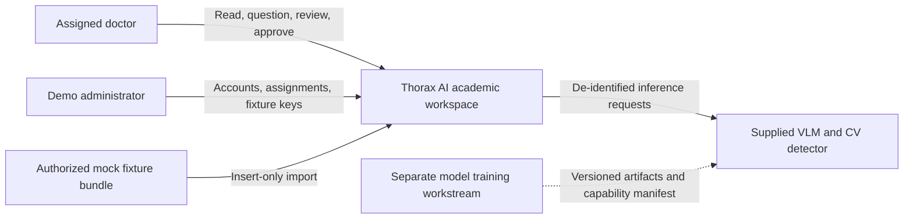

Training is an external dependency supplying artifacts, not a runtime application workflow. Only mock/authorized de-identified assets are imported. Admins cannot use clinical routes or view clinical audit payloads.

### 2.2 DIA-002 — Containers and components

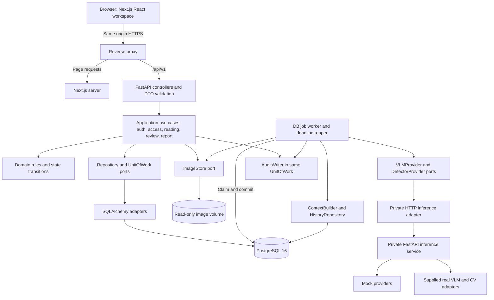

API business modules share a database and one transaction boundary. The worker runs the same application/domain package in a separate process; it is not a second business backend. Inference receives image bytes/crops and sanitized clinical context, never SQL credentials, browser cookies, patient names/codes, or arbitrary filesystem URLs. Browser downloads images only through an authorized API stream. Medical data is not put in Next.js static generation, CDN caches, or browser persistent storage.

### 2.3 Technology choices and constraints

| Technology | Responsibility and integration | Rationale / alternative / constraint |
|---|---|---|
| Next.js 15, React, TypeScript | App Router screens and client workspace; same-origin `/api/v1` fetch. | PDF choice retained over older bare React plan. Do not create Next.js clinical server actions duplicating API rules. Patched version/React compatibility locked in TASK-001. |
| Tailwind CSS, accessible headless primitives | Tokens/layout and keyboard dialogs/menus; SVG icons. | Existing PDF stack, with native semantic controls first. No new component framework required. Exact compatible version locked, not guessed here. |
| TanStack Query | Authorized server cache, polling, mutation invalidation. | Avoid hand-built synchronization; local React state sufficient for viewer/drafts; introduce no separate global state library initially. |
| FastAPI, Pydantic 2, Python 3.12 | DTO parsing, REST, OpenAPI generation; typed application commands. | Matches PDF and research language; Express rewrite adds no value. [FastAPI](https://fastapi.tiangolo.com/) / [Pydantic models](https://docs.pydantic.dev/latest/concepts/models/). |
| SQLAlchemy 2 + Alembic | PostgreSQL repositories, explicit transactions/migrations. | PDF choice; ORM objects never cross domain/API boundaries. [SQLAlchemy transactions](https://docs.sqlalchemy.org/en/20/orm/session_transaction.html) / [Alembic](https://alembic.sqlalchemy.org/en/latest/). |
| PostgreSQL 16 | Clinical records, audit, job queue, auth expiry. | PDF choice; SQLite cannot validate the same locking/constraint behavior. `SKIP LOCKED` is suitable for queue consumers, not clinical reads. [PostgreSQL SELECT](https://www.postgresql.org/docs/16/sql-select.html). |
| Private FastAPI inference service | `/internal/v1/analyze`, `/ask`, `/draft-report`, `/detect` and capability manifest. | Mock/real provider interface stays stable. Network/internal token auth; no public browser route. |
| Pillow | Import validation, orientation canonicalization and server ROI crop. | Established image handling; limit decoded pixels/bytes, strip metadata; do not modify source asset during viewer actions. |
| bcrypt library | Password hashes per PDF. | Enforce <=72 UTF-8 bytes to avoid truncation, cost calibrated <=500ms on demo hardware (initial cost12). No custom password cryptography. |
| Docker Compose + reverse proxy | Web, API, worker, DB, inference services and named volumes. | One-command startup; no Kubernetes, Redis, Celery, cloud platform requirement. CPU mock profile runs without GPU; real profile uses supplied runtime/GPU constraints. |
| pytest, HTTPX; Vitest/Testing Library; Playwright | Domain/integration/provider and browser tests. | Real PostgreSQL tests for constraints; no SQLite substitute for concurrency tests. Reuse research evaluation tooling only outside app tests. |

At implementation resolve exact compatible versions, dependency locks and image digests; retain a software bill of dependencies. Documentation does not invent versions for libraries not yet chosen. Model packages/runtime can conflict with API dependencies, so inference uses a separate lock/container.

### 2.4 Repository shape and dependency direction

All paths in this tree are **TO CREATE**, not a scaffold delivered now.

```text
docs/{spec.md,implementation_plan.md,frontend_des.md}
apps/api/
  pyproject.toml, uv.lock, alembic.ini
  thorax/domain/{reading.py,findings.py,report.py,annotation.py,errors.py}
  thorax/application/{auth.py,access.py,admin.py,reading.py,ai_jobs.py,
                      context.py,review.py,reporting.py,ports.py}
  thorax/infrastructure/db/{models.py,repositories.py,unit_of_work.py}
  thorax/infrastructure/{auth_sessions.py,image_store.py,inference_http.py,audit.py}
  thorax/presentation/{api.py,dependencies.py,schemas.py,routes/}
  thorax/worker/{main.py,claims.py,reaper.py}
  migrations/versions/
  tests/{unit,integration,contracts}/
apps/web/
  package.json, pnpm-lock.yaml
  src/app/{login,worklist,patients,admin}/
  src/features/{auth,worklist,workspace,viewer,chat,findings,report,analysis,annotations,audit,admin}/
  src/components/{Button,Dialog,StatusBadge,ErrorNotice}/
  src/lib/api/{client.ts,contracts.ts}
  src/lib/queryKeys.ts
  tests/{components,e2e}/
services/inference/
  pyproject.toml, model-runtime.lock
  app/{api.py,schemas.py,capabilities.py,vlm.py,detector.py,mock.py,real_vlm.py,real_cv.py}
  tests/contracts/
fixtures/demo/{manifest.json,patients.json,studies.json,past_reports.json,images/}
infra/{compose.yaml,proxy.conf,api.Dockerfile,web.Dockerfile,inference.Dockerfile}
scripts/{bootstrap.py,verify_demo.py}
.env.example
```

Domain depends only on Python standard library/value objects. Application depends on domain and Protocol ports. Infrastructure implements ports and may import SQLAlchemy/HTTPX/Pillow; presentation imports application and Pydantic DTOs. Worker composes application ports, never bypasses review rules. Domain cannot import ORM, FastAPI, model libraries or HTTP. Controllers cannot query ORM directly. Frontend feature components invoke typed API clients; they cannot access DB/model URLs. Research `cxr_research` is not imported into domain; a real inference adapter may load its exported artifact under a separately tested adapter. No copying research scripts into controllers.

## 3. Persistence model

### 3.1 DIA-003 — Entity relationship diagram

Every table has `id bigint PK` and `created_at timestamptz NOT NULL DEFAULT now()`. In this diagram `NN` in the attribute comment means NOT NULL; `NULL` means nullable. `jsonb` fields have schemas described below. Enum names here mean SQL CHECK values or PostgreSQL enums, consistently migrated; do not invent additional states.

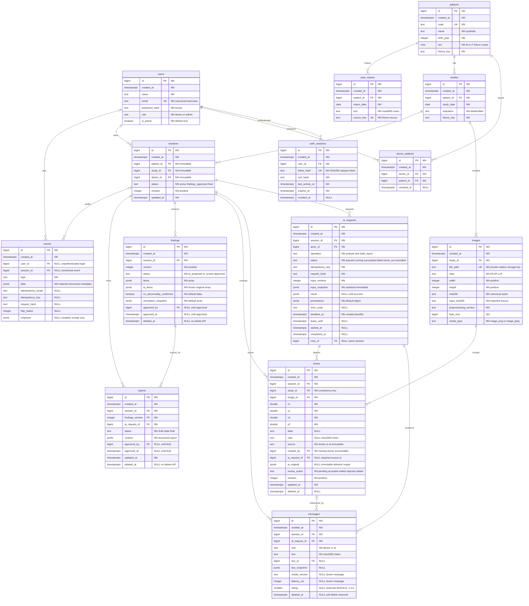

SQL uses `double precision` for diagram type `double`; `char(1)` for sex; image MIME values in JSON/SQL are literal `image/png` and `image/jpeg` (the ERD comment spells them to keep diagram parsing simple). `studies.status` from the PDF is replaced with an explicit **derived projection**, not an independently editable column. Every study must contain >=1 image when its import transaction commits (deferred constraint trigger). The diagram's one-or-more image cardinality expresses this import invariant.

### 3.2 Constraints, nulls, indexes and ownership

All FKs use `ON DELETE RESTRICT`; application roles have no hard-delete privilege on clinical/audit tables. No patient, study, message, findings or report DELETE API exists. `boxes` uses a tombstone. Reserved `deleted_at` columns preserve future soft-delete behavior without making it an MVP UI feature. Audit tables are append-only; DB trigger rejects UPDATE/DELETE for runtime roles. Administrative assignment DELETE means setting `revoked_at`, not SQL DELETE.

| Table | Uniqueness / CHECK / immutability | Additional indexes and integrity |
|---|---|---|
| users | `lower(email)` unique, canonical lower-case email; role doctor/admin; active Boolean NN. | No email/password in login-failure events. Trigger rejects assigning a non-doctor in `doctor_patients`. |
| auth_sessions | unique token_hash; expiry >= last_activity_at; never store raw bearer token/password. | `(user_id,revoked_at)`, `expires_at`; token lookup unique index. |
| patients | unique code; birth_year 1900..import year; sex M/F is fixture limitation, not a clinical schema claim. | `fixture_key`, lower(name)/lower(code) prefix-search indexes; no generalized production demographics. |
| doctor_patients | unique `(doctor_id,patient_id)`, referenced user must be doctor; revoke retains row. | `(doctor_id,patient_id) WHERE revoked_at IS NULL`; grants can reactivate same row. |
| studies | unique `(id,patient_id)` for composite FK; study_date immutable after import. | `(patient_id,study_date DESC,id)`; clinical fixture values never overwritten. |
| images | unique `(id,study_id)`; width,height >0; max8192 per side and <=40MP/20MiB import limit. | study_id; SHA256 and storage key checked during import; image update forbidden after import. |
| past_reports | max8000 chars, nonempty text, unique source_key. | `(patient_id,report_date DESC,id DESC)`; immutable after import. |
| sessions | unique `(study_id,doctor_id)`; unique `(id,study_id)` and `(id,doctor_id)`; FK `(study_id,patient_id)` to studies. Immutable identity trigger. | `(doctor_id,updated_at DESC)`, `(patient_id)`; revision>=1. No session can be rebound by PATCH. |
| ai_requests | unique `(session_id,actor_id,operation,idempotency_key)`; unique `(id,session_id)`; composite `(session_id,actor_id)` to sessions `(id,doctor_id)`; self FK `(retry_of,session_id)` to `(id,session_id)`. | Unique `(session_id) WHERE status IN ('queued','running')`; `(status,created_at,id)` for claims; deadline and completion constraints; immutable input snapshot. |
| messages | unique `(ai_request_id,role)`; `(ai_request_id,session_id)` composite FK. `(box_id,session_id)` FK to boxes `(id,session_id)` when non-null. | `(session_id,id)`; only successful ask pairs enter context. No user message is inserted before job success; failed question remains in failed job snapshot for retry. |
| boxes | unique `(id,session_id)`; FK `(session_id,study_id)` to sessions and `(image_id,study_id)` to images; created_by must equal session owner. Source/ai_original immutable. | `(session_id) WHERE deleted_at IS NULL`; `(image_id)`; `0<=x1<x2`, `0<=y1<y2`; dimension bounds checked by trigger against referenced image. `(ai_request_id,session_id)` FK when non-null. |
| findings | unique `(session_id,version)`; approval user/time both present iff approved; approver=session owner. Approved row immutable trigger, including JSON snapshots. | `(session_id,version DESC)`; JSON schemas/application checks described below. |
| reports | FK `(session_id,findings_version)` to findings `(session_id,version)`; request+session FK; at most one draft and at most one final per session by separate partial unique indexes. | `(session_id,id DESC)`; approver/time iff final; final row immutable trigger; approved source and current version validated under session lock. |
| events | partial unique `(user_id,idempotency_scope,idempotency_key) WHERE idempotency_key IS NOT NULL`; either all receipt columns set or all null. | `(session_id,id)`, `created_at`, `(type,created_at)`; no audit FK owns/deletes clinical records. |

Row-local CHECKs cannot validate another table or arbitrary JSON ID references: do not pretend they do. [PostgreSQL constraint behavior](https://www.postgresql.org/docs/16/ddl-constraints.html). Composite FKs/constraint triggers enforce identity relationships; application validation inside a locked transaction enforces `items[].box_ids`, included IDs, role permissions and latest-approved-source rules. Migration tests must deliberately violate both sets. All relations to optional deleted boxes remain valid because rows are retained.

### 3.3 JSON schemas and provenance

`FindingItem`: `{id:string,text:string,location:string|null,image_id:int,source:'ai'|'doctor',action:'pending'|'accepted'|'edited'|'rejected'|'added',box_ids:int[]}`. Text 1..2000 chars after trim, location<=200; maximum50 items, unique IDs. AI IDs are backend-assigned stable strings scoped to the findings lineage. Clients cannot relabel an AI item as doctor-created or remove it to bypass pending review: rejected items remain. Doctor additions have new server-validated IDs/source=doctor/action=added; an addition can later be marked rejected. `ai_items` stores validated original VLM output once, never overwritten. `image_id` must belong to the session study; current analyze result uses the selected image only. An empty initial result is allowed; explicit normal confirmation is then required at Gate1.

`annotation_snapshot`: approved active accepted/edited/added boxes as `{box_id,revision,image_id,bbox_xyxy,label,note,source,review_action,ai_request_id}`. Rejected/deleted boxes are not approved annotation evidence but remain in boxes/events. Approved snapshots are independent of later mutable overlays.

`ReportContent`: `{patient:{id,code,name,birth_year,sex},study:{id,study_date,indication,image_ids,analyzed_image_id},comparison:string,findings:string,impression:string,recommendation:string,source_item_ids:string[]}`. Patient/study are filled and frozen by backend from authorized DB records. `image_ids` lists the study assets; `analyzed_image_id` identifies the single image actually analyzed by AI. Initial `findings` is a deterministic ordered join of included approved item texts; explicit normal produces a fixed doctor-confirmed normal statement. VLM drafts the remaining narrative using approved items only; normal confirmation requires an empty included list and empty source_item_ids. On save doctor may edit narrative fields; source reference/version remains immutable. Structural evidence-ID validation cannot prove semantic truth; Gate2 explicitly reviews language. Maximum8000 chars per narrative field; findings/impression required nonempty for finalization; comparison/recommendation may be empty. No model-produced identity fields are accepted.

`AIProvenance`: `{provider_mode,vlm_artifact:{id,version,sha256}|null,cv_artifact:{id,version,sha256}|null,prompt_version,preprocessing_version,image_sha256,history_report_ids,history_hashes,message_ids,box_snapshot,source_findings_version,started_at,completed_at,latency_ms,invocations:[]}`; fields irrelevant to operation are null/empty. Each invocation records `{operation,artifact,started_at,completed_at,latency_ms,status,error_code,output_hash}`. Analyze and detect are separately accounted for, even when only one succeeds; store their original sanitized outputs in protected provenance `provider_outputs` for audit, but never publish failed partial output as findings/boxes/messages/report. The public AIRequest provenance projection omits provider_outputs and raw input snapshots. Store model output in authorized DB job/result fields, not operational logs. `events.data` references request/resource IDs and timings; never passwords, cookies, patient name, image bytes or raw prompt text.

## 4. Code-level model

### 4.1 DIA-004 — UML class design

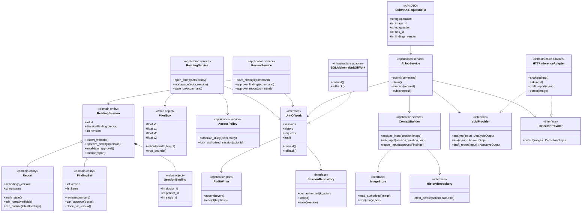

This diagram is deliberately not a second ERD. `SessionBinding` and `PixelBox` are immutable values, not tables. `FindingSet.can_approve` owns item/disposition rules; `Report.can_finalize` owns source-version/state checks; `ReviewService` coordinates locking, repositories and atomic audit. DTOs parse input but cannot authorize it. Infrastructure converts ORM records to domain entities and returns domain errors mapped centrally to API errors.

### 4.2 Collaboration diagrams

DIA-005 shows initial analysis; nested numbering identifies subcalls of message 2/3. Directed return edges name persisted results. DIA-006 shows approval responsibility rather than duplicating the database relations.

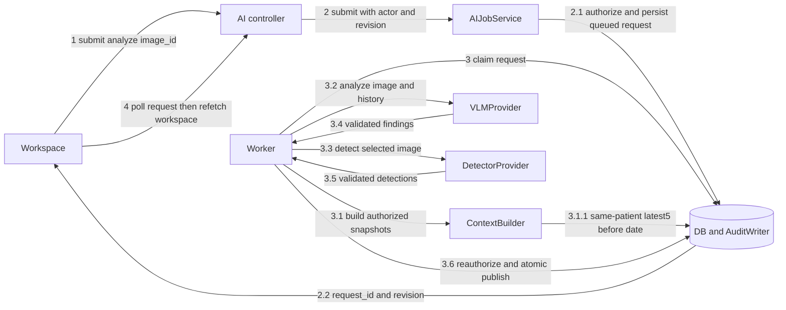

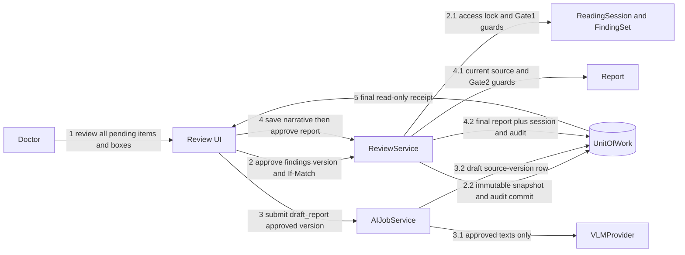

## 5. Workflow diagrams

### 5.1 DIA-007 — Complete activity flow

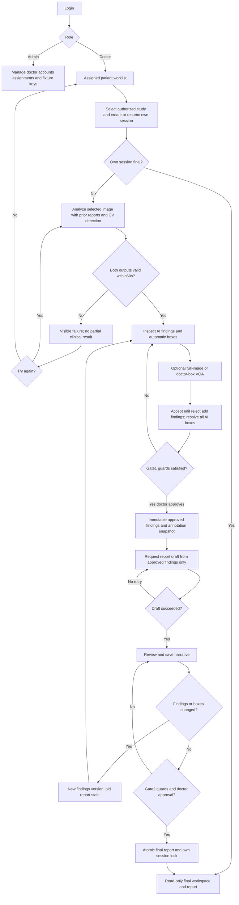

No chat or manual box is required before Gate1 if the doctor has no question. All automatic suggestions still require a disposition. No new analysis is required when reopening a session with an already successful analysis.

### 5.2 DIA-008 — Authentication and authorized study access

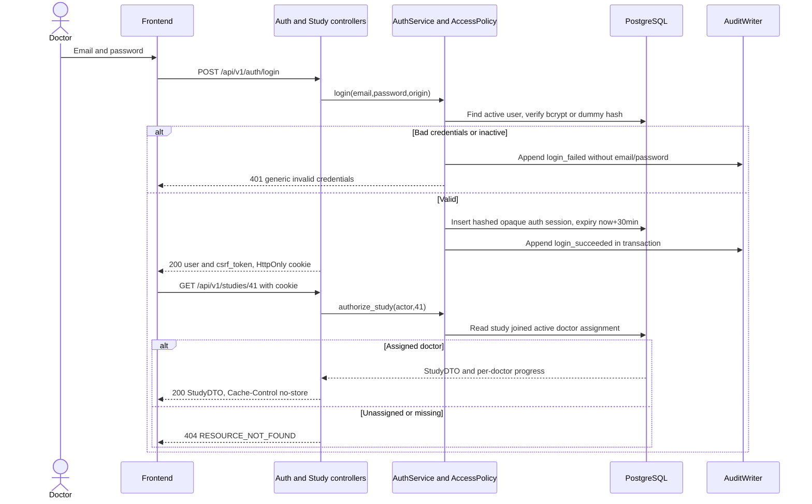

### 5.3 DIA-009 — Study selection and immutable session creation

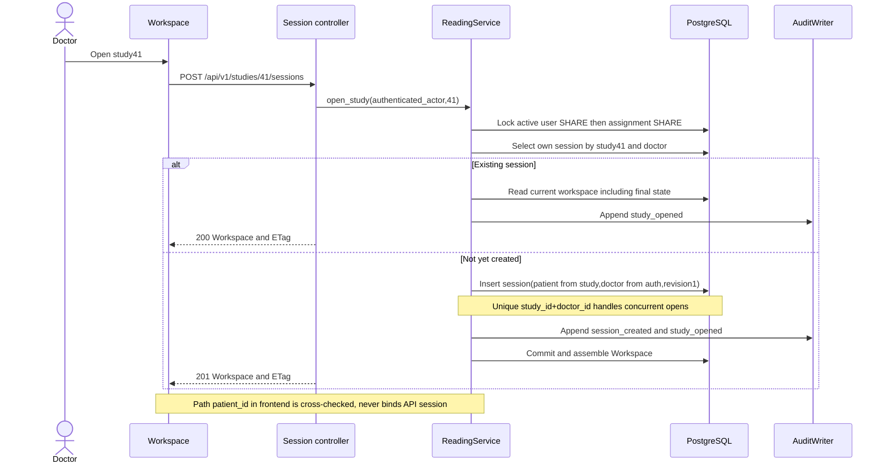

### 5.4 DIA-010 — Initial analysis with history and CV detection

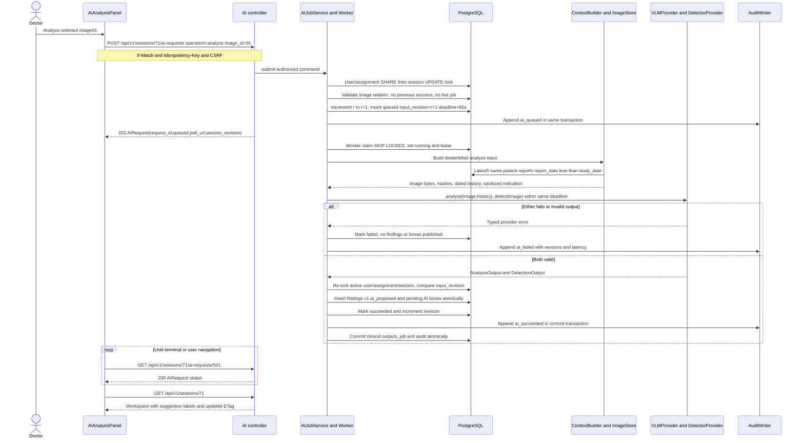

### 5.5 DIA-011 — Multi-turn VQA

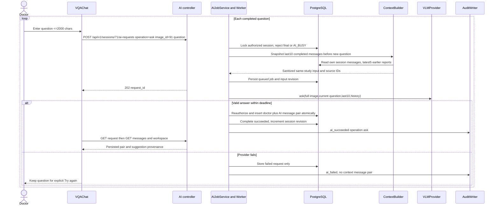

Chat never directly changes reviewed findings. A doctor must explicitly add/edit findings before approved content can use an answer. Context includes previous ten messages, not ten turns; a full history remains pageable in storage/UI.

### 5.6 DIA-012 — Box creation and ROI-specific question

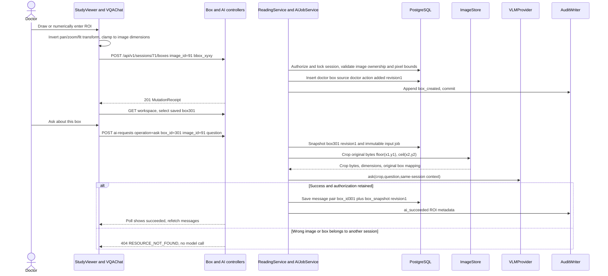

The `POST ai-requests` path in this diagram abbreviates the same full `/api/v1/sessions/71/ai-requests` endpoint shown in the preceding diagrams; it is not a second API. Crop context identifies that the image is a region, without claiming full-image coverage. Moving/deleting a box later does not rewrite the earlier question's snapshot.

### 5.7 DIA-013 — Findings review and Gate1

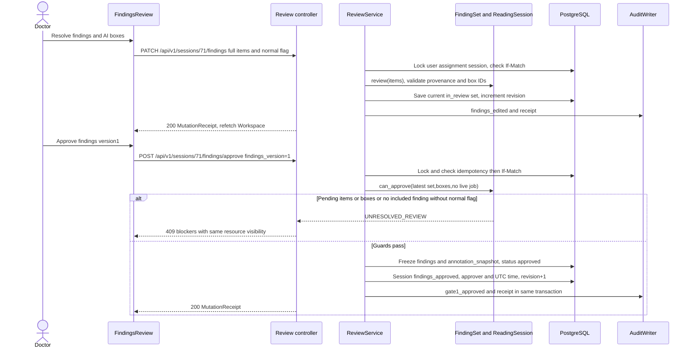

### 5.8 DIA-014 — Report generation and Gate2

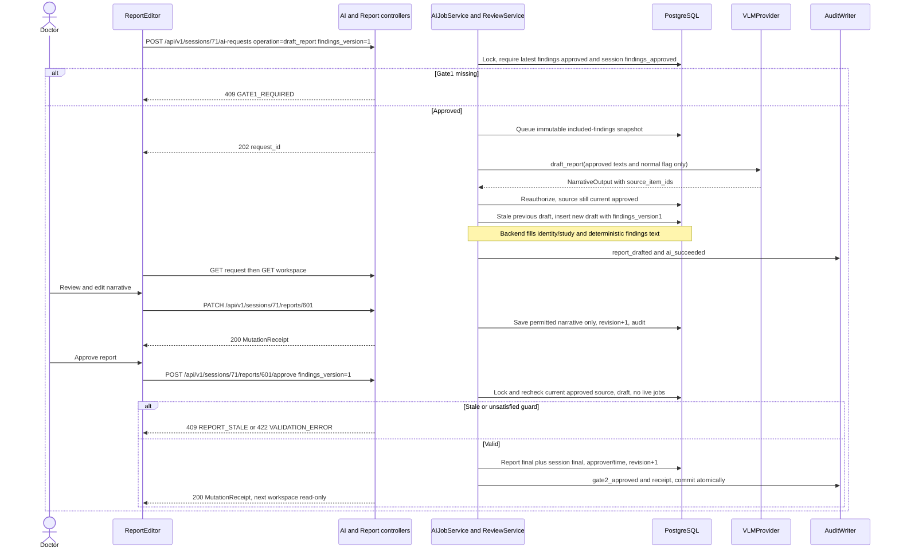

Field validation maps to HTTP422 `VALIDATION_ERROR`; semantic stale guards map to HTTP409. The combined diagram label does not change that distinction.

### 5.9 DIA-015 — Findings edits, stale reports and re-approval

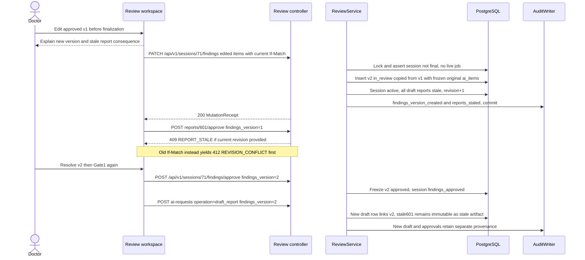

Box geometry, label, note, deletion or review-disposition edits after Gate1 trigger the same invalidation transaction. Inserting a new box does too. Chat alone does not change findings or invalidate an approval. Amendment of final sessions is rejected, never cloned through this pre-finalization route.

### 5.10 DIA-016 — Failure, timeout, worker loss and retry

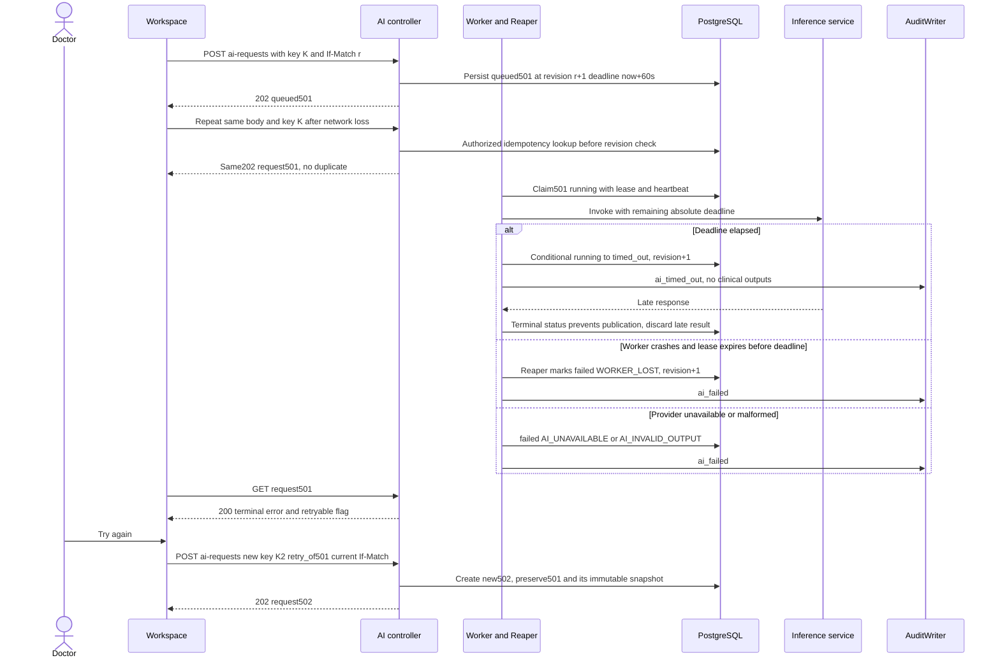

The retry command sends the original input unchanged except `retry_of`; if the doctor edits the question/box, submit a new request without `retry_of`. No automatic retry can multiply paid/expensive inference. Cancelling the browser poll does not cancel the persisted server job.

### 5.11 DIA-017 — Unauthorized and cross-patient access

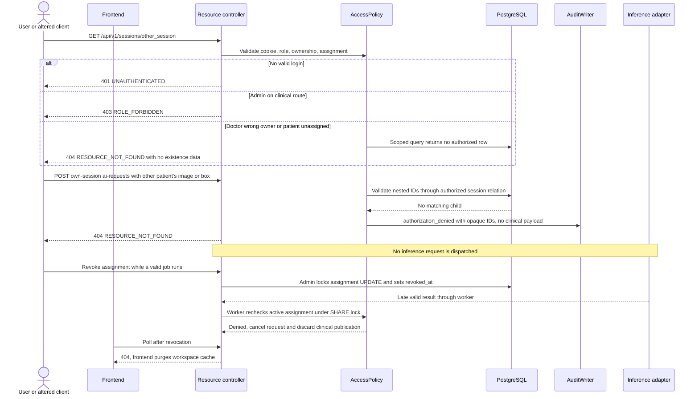

The final four messages describe worker publication through the same application policy, not an inference service callback endpoint. There is no public callback API. Authorization-denial events must not themselves disclose hidden resource details through an audit viewer.

## 6. Canonical transition diagrams

Guards and rejection codes are normative. All unspecified transitions are rejected with409, or404 if the resource is not authorized. Transport/schema failures use401/403/412/422/428 as specified later. States are server-owned.

### DIA-018 — Session

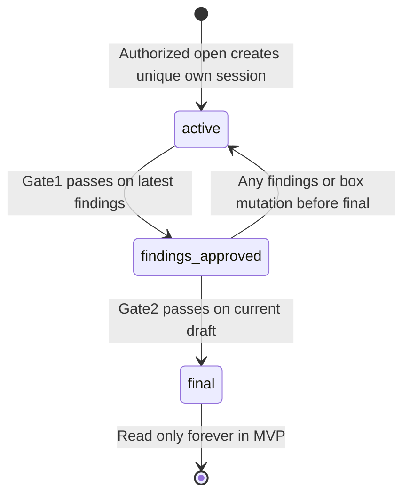

Reading/reopening does not create a state transition. In `findings_approved`, chat is permitted but findings/box changes clone a new review version. Final has no outgoing clinical edit transition; the terminal arrow expresses lifecycle completion, not deletion. Study status is a derived aggregate: `final` if any own-doctor session is final; otherwise `in_progress` if any session exists; otherwise `new`. Each doctor's worklist also exposes own-session status separately.

### DIA-019 — Findings set

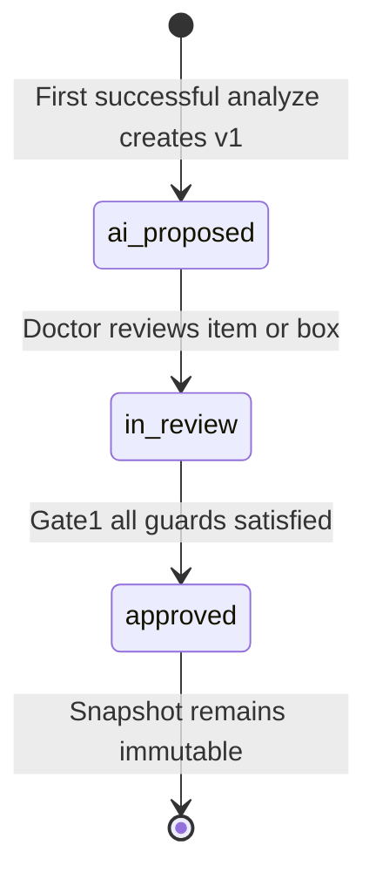

Editing an approved set **creates another entity** at version+1 in `in_review`; it never transitions the old approved row back. Gate1 requires a saved `in_review` set. Even an empty initial AI list requires saving explicit doctor normal confirmation (or added findings), which moves it to `in_review`; `ai_proposed -> approved` is rejected.

### DIA-020 — Report

```mermaid
stateDiagram-v2
  [*] --> draft: Successful draft_report from latest approved findings
  draft --> draft: Saved narrative edit with current revision
  draft --> stale: Findings or box changed or replacement draft published
  draft --> final: Gate2 source still current approved
  stale --> [*]: Retained read only; regenerate creates a new row
  final --> [*]: Immutable final snapshot
```

There is no `not_created` row, no `stale -> draft` resurrection, and no edit to a final report. Re-generation stales the previous draft only when the new generation succeeds; a failed generation preserves the existing draft.

### DIA-021 — AI request

```mermaid
stateDiagram-v2
  [*] --> queued: Authorized idempotent submit
  queued --> running: Worker claims before deadline
  queued --> timed_out: Absolute60s deadline elapsed
  queued --> cancelled: Assignment or actor revoked
  running --> succeeded: Valid outputs and authorized atomic publication
  running --> failed: Provider error invalid output or lost worker lease
  running --> timed_out: Deadline elapsed
  running --> cancelled: Actor revoked or context cannot publish
  succeeded --> [*]
  failed --> [*]
  timed_out --> [*]
  cancelled --> [*]
```

Context-revision mismatch is `cancelled` with `CONTEXT_CHANGED`; no update to clinical artifacts. A retry creates a new queued row with `retry_of`; terminal rows never restart. Runtime asset/input validation happens after worker claim, so failures use `queued -> running -> failed`; a direct `queued -> failed` transition is not allowed.

### DIA-022 — Annotation overlay

```mermaid
stateDiagram-v2
  [*] --> active: Insert AI pending or doctor added box
  active --> active: Authorized geometry note label or disposition edit
  active --> deleted: Soft delete before final
  deleted --> [*]: Retained tombstone; no restore API in MVP
```

`review_action` is separate from overlay lifecycle. AI starts `pending`; doctor can set `accepted`, `edited` (with actual correction) or `rejected`; doctor boxes start `added`. Rejected boxes remain active records but are excluded from approved evidence and rendered as hidden-by-default rejected overlays. Deleting a pending box counts as resolved rejection and sets review_action=rejected plus deleted_at. Source never changes when a doctor edits a detector box. Gate1 snapshots approved evidence; Gate2 freezes every overlay in that session.

## 7. REST contracts

### 7.1 Conventions, identity and shared errors

Base URL `/api/v1`; UTF-8 JSON with snake_case; integer IDs are positive and <=JavaScript `Number.MAX_SAFE_INTEGER` for this demo. Datetimes are ISO8601 UTC with `Z`; study/report dates are ISO dates. Unknown body fields are rejected (`extra='forbid'`), never silently ignored. There is no client-supplied actor/patient override in session commands. IDs in the following examples are synthetic fixture IDs, not references to actual patients.

**Policies used in endpoint tables:** `PUBLIC` means login/health only; `AUTH` means active unexpired authenticated user; `ADMIN` means AUTH and role=admin; `DOC` means AUTH doctor plus active assignment; `OWN` adds session.doctor_id=current user and every nested child relation. ADMIN on clinical routes gets403; DOC without assigned/owned resource gets the same404 as a missing ID. Every endpoint except health/login requires a login cookie, including image streams and events. Inference routes use a private service credential instead of a human login.

**Cookie/CSRF:** create a cryptographically random >=256-bit opaque login token; store SHA256 token hash only. `thorax_session` cookie is HttpOnly, SameSite=Lax, Path=/, Secure in HTTPS; loopback-only HTTP demo may disable Secure by explicit environment flag. Idle expiry is exactly30min after last accepted human activity. Return `expires_at` in login and `/auth/me`. Derive the CSRF token by HMAC-SHA256 of the raw cookie token with a separate environment secret so `/auth/me` can reproduce it across page reloads without rotating other tabs; store its hash in auth_sessions. Require `X-CSRF-Token` and same-origin Origin on mutations; login checks Origin and JSON content type. No bearer in localStorage. `/auth/logout` revokes the current token; repeated logout returns204 and expires cookie.

GET polling, image loading, prefetch, events refresh and health never refresh idle expiry. A deliberate navigation GET with `X-User-Activity: 1` or an accepted human mutation may touch last_activity_at/expires_at, after checking the old expiry first. `/auth/me` with that header implements explicit Continue session; background `/auth/me` without it does not extend login. Client timestamp is never authoritative. At idle expiry return401, purge clinical cache/drafts and require login; persisted server work remains resumable. Login returns the same generic401 for bad email, password, disabled user. Rate-limit login at5 attempts/min per IP at proxy and10 failed attempts/15min per normalized-account hash at API; return429 with Retry-After, never expose account existence. Salt/HMAC hash the account/IP audit keys; never store supplied password or plain failed-login email in events.

**Concurrency:** Workspace uses strong `ETag: "17"` corresponding to `session.revision=17`. All clinical writes except natural-idempotent session-open require `If-Match`; missing428, stale412. Even when a box/report has a local revision, the parent session ETag serializes the clinical aggregate. Responses include the new ETag when a session revision changes. Required `Idempotency-Key` (16..128 printable ASCII) for AI submissions, box creation and approval commands; recommended for PATCH/box DELETE; admin create/import/assign also require it. A network retry reuses key/body; a new intentional operation uses a fresh key. Idempotency is checked **after current authorization, before stale ETag**, using canonical JSON body hash (plus route/operation); mismatched body409. Failed validation before commit does not consume key. Clinical idempotency receipts live in events with session-specific scope; administrative receipts use route-specific scope. AI submissions store keys in ai_requests. No password, cookie, clinical narrative or raw prompt goes into receipt JSON.

`MutationReceipt`: `{resource_type:string,resource_id:int|string,session_revision?:int}`. `resource_type` is one of doctor, assignment, fixture, box, findings, report. Return the original HTTP status/receipt on replay; clients refetch authorized Workspace. Login, logout, natural session-open and reads use their own response schemas. There is no empty optimistic finalization response.

**ErrorEnvelope** (all HTTP errors, including mapped Pydantic errors):

```json
{
  "error": {
    "code": "REVISION_CONFLICT",
    "message": "This reading changed in another tab. Reload it before saving.",
    "request_id": "req-9f5d2b",
    "details": [{"field": "If-Match", "reason": "current_revision", "value": 18}]
  }
}
```

Never include a current revision/value in a404 about an inaccessible resource. Details identify validation fields, never hidden patient values. Unexpected exceptions return500 INTERNAL_ERROR with request_id, and a redacted operational trace. Shared `E` below means401 UNAUTHENTICATED,403 ROLE_FORBIDDEN/CSRF_INVALID,404 RESOURCE_NOT_FOUND as applicable,422 VALIDATION_ERROR; write tables additionally use `W`=428 PRECONDITION_REQUIRED,412 REVISION_CONFLICT,409 FINAL_READ_ONLY/AI_BUSY/IDEMPOTENCY_CONFLICT as applicable. Errors are explicit contract values, not free-form provider exceptions.

| Code | HTTP / where | Deterministic meaning and recovery |
|---|---|---|
| UNAUTHENTICATED | 401 | Missing/invalid/revoked/expired cookie; reauthenticate. |
| ROLE_FORBIDDEN, CSRF_INVALID | 403 | Wrong role or invalid mutation protection; no clinical dispatch. |
| RESOURCE_NOT_FOUND | 404 | Missing, unassigned, wrong owner, or nested cross-study ID; same safe text. |
| AI_BUSY | 409 | One queued/running job exists; poll it before further clinical mutation. |
| FINAL_READ_ONLY | 409 | Own session finalized; no mutation or further AI request. |
| GATE1_REQUIRED | 409 | Latest findings not approved/current; review and approve. |
| UNRESOLVED_REVIEW | 409 | Pending AI findings/boxes or no included result without explicit normal; return visible blocker IDs. |
| REPORT_STALE | 409 | Report source not latest approved version, or row stale; regenerate after Gate1. |
| ALREADY_ANALYZED | 409 | One successful initial analysis already exists; use review/chat, not new analyze. |
| ANALYSIS_REQUIRED | 409 | Initial analysis has not succeeded; ask, all box writes and findings review remain unavailable until it does. |
| IDEMPOTENCY_CONFLICT | 409 | Same actor/scope/key with different canonical body. |
| REVISION_CONFLICT | 412 | ETag stale; refetch; never overwrite automatically. |
| VALIDATION_ERROR, PHI_IN_MODEL_INPUT | 422 | Concrete field/bounds/schema error or known current-patient identity in model-bound text. |
| PRECONDITION_REQUIRED | 428 | Missing If-Match on clinical write. |
| RATE_LIMITED | 429 | Login/request-rate guard; Retry-After. |
| AI_UNAVAILABLE | 503 submission preflight only | Configured inference service known unavailable; retry explicitly. An already accepted job reports failure through polling instead. |

Worker result errors (poll200 terminal state) include AI_UNAVAILABLE, AI_INVALID_OUTPUT, AI_CONTEXT_TOO_LARGE, AI_DEADLINE_EXCEEDED, WORKER_LOST, ASSET_UNAVAILABLE, AUTHORIZATION_REVOKED, CONTEXT_CHANGED, PHI_IN_MODEL_INPUT. Timeout sets `timed_out`; revoked/context-changed sets `cancelled`; remaining cases set `failed`. Persist `retryable` false for authorization/context/schema input failures, true for transient provider/worker/timeout failure. Never automatically change provider mode.

### 7.2 Read DTOs and validation vocabulary

| DTO | Fields / bounds |
|---|---|
| UserDTO | `id,name,email,role,is_active`; no password hash. Login and me add `csrf_token,expires_at`. |
| Page<T> | `{items:T[],next_cursor:string\|null}`; default limit25, max100 (messages max50). Cursor opaque validated keyset token bound to actor/filter, invalid cursor422. |
| PatientSummary | `id,code,name,birth_year,sex,study_count`; assigned doctor only. Search1..100 chars, case-insensitive name/code substring, parameterized SQL, not a model search. |
| StudyDTO | `id,patient_id,study_date,indication,image_count,status,own_session_id,own_session_status`; `status` aggregate new/in_progress/final, `own_session_status` null/active/findings_approved/final. Images added on detail endpoint. |
| ImageDTO | `id,study_id,view,width,height,sha256,media_type,content_url`; never private file_path. Default image PA then AP then LAT, ties id. |
| BoxDTO | `id,image_id,bbox_xyxy:[x1,y1,x2,y2],label,note,source,review_action,revision,deleted_at,ai_request_id`; never allow client to set provenance. |
| FindingsDTO | `id,version,status,items,ai_items,no_abnormality_confirmed,annotation_snapshot,approved_by,approved_at`. Includes immutable original suggestions for comparison. |
| ReportDTO | `id,findings_version,status,content,approved_by,approved_at,updated_at`; stale/final read-only. |
| MessageDTO | `id,role,text,image_id,box_id,box_snapshot,model_version,latency_ms,created_at`; image_id is derived from linked job input, rating reserved for SHOULD. |
| AIRequest | `request_id,operation,status,poll_url,session_revision,deadline_at,retry_of,error:null\|{code,message,retryable},provenance,output_refs`; output_refs `{findings_version?,box_ids?,message_ids?,report_id?}`, never large image/base64. GET polling additionally returns `submitted_input` containing only the original public command fields for the authorized owner (operation/image_id/question/box_id/findings_version/retry_of as applicable); no assembled history, hidden context or private path. |
| Workspace | `session:{id,doctor_id,patient_id,study_id,status,revision},patient,study,images,history,latest_findings,reports,boxes,messages,live_request_id,blockers,capabilities`. `history` latest<=5 `{id,report_date,text}` eligible reports, full text allowed to assigned doctor; `messages` is Page<MessageDTO> containing latest50 in chronological order and an older-page next_cursor; boxes include active and tombstoned references needed for chat; reports full pre-final/final rows. |
| Capabilities | `{provider_mode:'mock'\|'real',can_detect:boolean,can_ask_roi:boolean,model_artifacts:[]}` describes configured interface, not measured clinical quality. Mixed provider modes forbidden for full acceptance; diagnostic mixed tests label each artifact. |
| Blocker | `{gate:'gate1'\|'gate2',code,resource_type,resource_id\|null,message}` computed server-side from guards; UI may preview but backend remains authoritative. |
| AdminDoctor | UserDTO for doctors only, plus `assigned_patient_ids:int[]`; no clinical session access. |
| AdminPatient | `{id,code,assigned_doctor_ids:int[]}`; assignment catalogue excludes name, dates, images, history, clinical counts. |
| FixtureStatus | `{fixture_key,checksum,status:'not_loaded'\|'loaded',patient_count,study_count,image_count}`; no clinical content. |

`Workspace.latest_findings=null` before successful analysis; `reports=[]` before drafting; `live_request_id=null` when idle. Workspace additionally includes `latest_ai_request: AIRequest|null` (with authorized submitted_input), so page reload can restore a failed request card or find an operation that completed while navigation was away. A live request takes precedence; otherwise show the most recent terminal request without re-running it. For retry_of, reuse the original context snapshot only while current image/box/message/approved-source identities and revisions still match; otherwise409 CONTEXT_CHANGED instructs a fresh intentional command. A thumbnail, if desired, uses the same authorized content route rather than a public URL. Worklist/study counts are not accessible to admin.

### 7.3 Authentication and administrative endpoints

These operations do not mutate clinical session state. No If-Match is required; transaction/unique constraints prevent duplicate accounts/assignments. `idempotent` column describes network retry behavior, not permission to repeat side effects with new keys.

| Method + path | Policy / purpose | Request / validation | Success DTO + status | DB operations, errors and retry |
|---|---|---|---|---|
| GET `/health` | PUBLIC liveness only | None | 200 `{status:'ok'}` | No data/model details or idle touch. Readiness detailed check is internal deployment probe, not public patient API. |
| POST `/auth/login` | PUBLIC, same Origin | `{email,password}`; email<=254, password8..72 UTF-8 bytes (seed/create passwords>=12); generic invalid response | 200 UserDTO+csrf_token+expires_at, Set-Cookie | Read users, insert auth_sessions and login event atomically;401 generic/403 origin/422 shape/429. No idempotency key; a new successful login may create another independent login session. |
| GET `/auth/me` | AUTH | Optional `X-User-Activity:1` for deliberate continue only | 200 UserDTO+csrf_token+expires_at | Read current login; conditional idle touch, never resurrect expired row; E. |
| POST `/auth/logout` | AUTH or already logged out; CSRF if valid cookie | Empty | 204 expires cookie | Soft revoke auth session and event; repeat204, natural idempotency. |
| GET `/admin/doctors` | ADMIN management list | cursor/limit | 200 Page<AdminDoctor> | Users(role doctor)+active assignment IDs; E. No other admin account management. |
| POST `/admin/doctors` | ADMIN create doctor | `{name,email,password}` name1..100, unique canonical email, password>=12 and<=72bytes; Idempotency-Key | 201 MutationReceipt doctor | Insert bcrypt hash, append account_created+receipt;409 EMAIL_IN_USE, E. Client cannot set role=admin. |
| PATCH `/admin/doctors/{doctor_id}` | ADMIN disable/reactivate | `{is_active:boolean}` only | 200 MutationReceipt doctor | Lock user UPDATE; set active; on disable revoke auth_sessions; audit+receipt. Doctor target only404. Idempotency key recommended; E. No changing identity/password/role in this MVP. |
| GET `/admin/patient-catalog` | ADMIN assignments only | cursor/limit, optional code search1..100 | 200 Page<AdminPatient> | Read patient IDs/codes and active doctor pairs only; E. |
| POST `/admin/assignments` | ADMIN grant/regrant | `{doctor_id,patient_id}` doctor active; Idempotency-Key | 201 MutationReceipt assignment | Lock doctor and existing assignment; insert or set revoked_at=null; already active still same assignment receipt201; E. No transfer of another doctor's session. |
| DELETE `/admin/assignments/{doctor_id}/{patient_id}` | ADMIN revoke | Empty | 204 | Lock assignment UPDATE; set revoked_at; repeat204 including absent pair after valid actor check. Append event only if state changes; reads/worker dispatch/commit then denied. No patient deletion. |
| POST `/admin/fixtures/imports` | ADMIN controlled mock import | `{fixture_key:string}` allowlisted slug<=80, no slash/path/URL; Idempotency-Key | 200 MutationReceipt fixture; resource_id=fixture_key | Verify manifest checksum/assets, insert entire fixture transaction, audit; same loaded checksum no-op.409 FIXTURE_CONFLICT for differing checksum/identity keys;422 FIXTURE_INVALID/unknown key;503 storage failure. Never overwrite existing clinical records. |
| GET `/admin/fixtures/imports/{fixture_key}` | ADMIN import status/catalogue manifest | Allowlisted fixture key | 200 FixtureStatus | Read allowlisted manifest plus matching imported fixture_key;404 unknown; E. Import is synchronous bounded12-patient bundle; no separate import-job entity or arbitrary uploads. |

### 7.4 Clinical read and session endpoints

| Method + path | Policy / purpose | Request / validation | Success DTO + status | DB operations, state and errors/retry |
|---|---|---|---|---|
| GET `/patients` | DOC worklist | search/cursor/limit; no arbitrary doctor_id filter | 200 Page<PatientSummary> | Active assignment join; no unassigned rows/count leakage; E. |
| GET `/patients/{patient_id}/studies` | DOC assigned patient | cursor/limit, descending date then id | 200 Page<StudyDTO> | Studies/images counts + own-session and aggregate statuses; E. |
| GET `/studies/{study_id}` | DOC assigned patient | Positive ID | 200 StudyDTO with images:ImageDTO[] | Study patient derives authorization; E. No session creation on GET. |
| GET `/images/{image_id}/content` | DOC assigned image study | No external file_path; validated internal path from row | 200 PNG/JPEG bytes, Content-Type, Content-Length, no-store | Resolve by study assignment;404 inaccessible,503 ASSET_UNAVAILABLE for authorized corrupt/missing asset; prevent traversal and do not expose paths. Original immutable bytes only. |
| POST `/studies/{study_id}/sessions` | DOC create/resume own reading | Empty body; ignore no client identity because unknown fields422 | 201 new /200 existing Workspace and ETag | User+assignment locks; unique `(study,doctor)` insert; append open audit. Natural idempotency; return existing final read-only too. E. |
| GET `/sessions/{session_id}` | OWN aggregate resume | Positive ID | 200 Workspace and ETag | Scoped read consistent snapshot, history temporal filters, latest messages50; E. Repeat safe; audit opening only via session-open POST. |
| GET `/sessions/{session_id}/messages` | OWN persisted conversation | cursor/limit<=50, chronological ascending page; initial Workspace gets latest50 | 200 Page<MessageDTO> | Same session, nondeleted messages; historical ROI snapshots survive deleted boxes. E; no mutation/delete API. |
| GET `/sessions/{session_id}/events` | OWN audit visibility | cursor/limit<=100 | 200 Page<{id,type,created_at,user_id,data}> | Return clinical metadata for this session only, excluding administrative idempotency internals/secrets. Admin403. E. |
| GET `/sessions/{session_id}/ai-requests/{request_id}` | OWN poll | Request must belong to path session | 200 AIRequest, Cache-Control no-store | Read status only, no idle touch. Terminal failure is HTTP200 with error/status; E. No inference is dispatched by polling. |

Workspace read uses a short read-only repeatable-read transaction so session revision, findings and reports are mutually consistent. The messages cursor points backward to the preceding older page, whose returned items are also chronological; this same older-page convention applies to GET messages. Images are streamed outside DB transaction after access check; a response already streamed before revocation cannot be recalled, but no new stream starts without checking assignment.

### 7.5 Clinical mutation endpoints

All rows require OWN+CSRF+If-Match, and use E+W. Check actor/assignment, existing replay, ETag and final/live-job guards before any mutation. Ask, every box write and findings review additionally require an existing successful initial analysis (otherwise409 ANALYSIS_REQUIRED). Audit write failure rolls the entire transaction back. Included success receipt has new session_revision.

| Method + path | Purpose / body | Specific validation | Success + database/state effect | Additional errors / retry |
|---|---|---|---|---|
| POST `/sessions/{session_id}/ai-requests` | `{operation:'analyze'\|'ask'\|'draft_report',image_id?,question?,box_id?,findings_version?,retry_of?}` | Discriminated body: analyze requires image_id only; ask requires image_id and question, optional box_id; draft_report requires findings_version only. Positive nested IDs, known identities stripped/rejected, context limits, required Idempotency-Key. retry_of same session+operation failed/timed_out retryable and identical original input. | 202 AIRequest. Increment session r->r+1, store queued input_snapshot and input_revision=r+1; one live request partial index. No clinical output yet. | ALREADY_ANALYZED, GATE1_REQUIRED, PHI_IN_MODEL_INPUT, AI_BUSY,503 preflight. Same key returns same job; new key for retry. |
| POST `/sessions/{session_id}/boxes` | `{image_id,bbox_xyxy,label?:string\|null,note?:string\|null}` | Bounds against same-study image; finite floats, min crop>=1x1 pixel after rounding, label<=200, note<=2000; source is always doctor; required Idempotency-Key. | 201 MutationReceipt box. Source doctor, review_action added; if post-Gate1 clone findings next version, session active and stale drafts in same transaction. Increment revision. |404 cross-image;422 bounds; Gate1 invalidation cannot be suppressed by client. |
| PATCH `/sessions/{session_id}/boxes/{box_id}` | `{bbox_xyxy?,label?,note?,review_action?}` at least one | Child belongs to session and not deleted; image/source cannot change. AI pending -> accepted/edited/rejected; doctor-added may remain added or rejected. Geometry/narrative changes to AI imply edited; accepting unchanged only. No re-pending. |200 receipt. Preserve ai_original; box revision+1 and parent revision+1; same post-Gate1 invalidation as creation. |422 invalid disposition/immutable field;404 deleted box. Recommend key for retry. |
| DELETE `/sessions/{session_id}/boxes/{box_id}` | Soft delete overlay | Child belongs to session; if already deleted and authorized, return original/no-op200 receipt with current session_revision; no second invalidation |200 receipt. First sets deleted_at and review_action rejected, logs before/after IDs+coords, increments revisions; invalidates Gate1 if needed. |No restore/hard delete; E+W on first request. Replaying recorded key precedes stale ETag. |
| PATCH `/sessions/{session_id}/findings` | `{items:FindingItem[],no_abnormality_confirmed:boolean}` full latest review set | <=50 items; preserve original AI IDs/source/image and rejected records; accepted text/location unchanged, corrections edited; active evidence boxes match session AND FindingItem.image_id; include text rules. Normal flag permitted only with zero included findings. |200 receipt findings. ai_proposed -> in_review, or update current in_review. Approved latest -> clone next in_review; old stays approved, session active, all drafts stale; revision+1. |422 unknown/missing AI IDs, bad box link;409 ANALYSIS_REQUIRED if initial analysis has not succeeded. No optimistic replace on412. |
| POST `/sessions/{session_id}/findings/approve` | `{findings_version:int}` | Required key; must equal latest saved in_review version, no pending AI findings/boxes, >=1 accepted/edited/added item with normal=false OR zero included with explicit normal=true, no live jobs. Included evidence must not reference rejected/deleted boxes. |200 receipt findings. Freeze snapshot, status approved, approver/time, session findings_approved; revision+1; append gate1_approved. |409 UNRESOLVED_REVIEW;409 FINDINGS_VERSION_MISMATCH. Already-approved same exact latest snapshot with a fresh key is200 no-op receipt, not a second approval event/version. |
| PATCH `/sessions/{session_id}/reports/{report_id}` | `{comparison?,findings?,impression?,recommendation?}` at least one narrative field | Report draft and source equals latest approved; fields strings<=8000; patient/study/version/source IDs uneditable. Empty saved field allowed during draft; required fields enforced at Gate2. |200 receipt report. Update narrative, audit, revision+1; no approval inferred from Save. |409 REPORT_STALE,422 immutable field; recommend key. Final blocked. |
| POST `/sessions/{session_id}/reports/{report_id}/approve` | `{findings_version:int}` | Required key; report draft, same source latest approved findings, session findings_approved, nonempty findings+impression, no live job. Client saves pending local edits first. |200 receipt report. Report and session final, signature/time and revision+1 atomically; gate2_approved. |409 REPORT_STALE/GATE1_REQUIRED;422 empty fields. Same original key authorized replay returns original success even though now final; fresh key on final returns409 FINAL_READ_ONLY. |

Additional specific errors EMAIL_IN_USE, FIXTURE_CONFLICT, FIXTURE_INVALID, FINDINGS_VERSION_MISMATCH, ANALYSIS_REQUIRED are HTTP409 except FIXTURE_INVALID422. A completed analyze can legitimately contain no findings or detections; it is not a provider failure. Missing required provider fields, NaN/out-of-bounds detection coordinates or malformed JSON are AI_INVALID_OUTPUT, not an empty success.

### 7.6 Concrete JSON examples

Submit ROI question after saving box301 (request header `If-Match: "17"`, `Idempotency-Key: roi-71-301-attempt-01`, CSRF omitted here for readability):

```json
{
  "operation": "ask",
  "image_id": 91,
  "question": "What is visible in this selected region?",
  "box_id": 301
}
```

```json
{
  "request_id": 502,
  "operation": "ask",
  "status": "queued",
  "poll_url": "/api/v1/sessions/71/ai-requests/502",
  "session_revision": 18,
  "deadline_at": "2026-11-06T08:01:00Z",
  "retry_of": null,
  "error": null,
  "provenance": {"provider_mode": "mock"},
  "output_refs": {}
}
```

Successful poll200 points to persisted message pair; frontend refetches Workspace/messages rather than placing transient provider text into another study's chat:

```json
{
  "request_id": 502,
  "operation": "ask",
  "status": "succeeded",
  "poll_url": "/api/v1/sessions/71/ai-requests/502",
  "session_revision": 19,
  "deadline_at": "2026-11-06T08:01:00Z",
  "retry_of": null,
  "error": null,
  "provenance": {
    "provider_mode": "mock",
    "vlm_artifact": {"id": "mock-vlm", "version": "fixture-v1", "sha256": "bbbbbbbbbbbbbbbbbbbbbbbbbbbbbbbbbbbbbbbbbbbbbbbbbbbbbbbbbbbbbbbb"},
    "cv_artifact": null,
    "prompt_version": "roi-v1",
    "preprocessing_version": "canonical-v1",
    "latency_ms": 250,
    "history_report_ids": [22],
    "message_ids": [101, 102],
    "box_snapshot": {"box_id": 301, "revision": 1, "image_id": 91, "bbox_xyxy": [240.2, 310.1, 410.6, 465.3]}
  },
  "output_refs": {"message_ids": [103, 104]}
}
```

Review body includes an AI rejection rather than deleting that source record:

```json
{
  "items": [
    {"id": "ai-1", "text": "Possible lower-zone opacity", "location": "left lower zone", "image_id": 91, "source": "ai", "action": "edited", "box_ids": [302]},
    {"id": "ai-2", "text": "Possible enlarged cardiac silhouette", "location": null, "image_id": 91, "source": "ai", "action": "rejected", "box_ids": []}
  ],
  "no_abnormality_confirmed": false
}
```

Gate1 `POST .../findings/approve {"findings_version":2}` returns200 `{"resource_type":"findings","resource_id":802,"session_revision":23}`. Report generation then submits `{"operation":"draft_report","findings_version":2}`; source version cannot be taken from an untrusted client without the latest-approved guard.

### 7.7 Private inference contract and model handoff

The application ports are logical interfaces; HTTP wire paths are below. Service requests use `Authorization: Bearer <private service token>` or an equivalent private deployment secret, internal networking and total deadline. There is no patient endpoint/model-side retrieval/tool execution. Inference service cannot ask the DB to retrieve another patient's information even when text requests it. It treats history, questions and findings as untrusted data under fixed task instructions.

| Private operation | Input | Output / strict validation | Failures and responsibility |
|---|---|---|---|
| GET `/internal/v1/capabilities` | Internal service auth | artifact IDs/hashes, operations, accepted media, context limits, coordinate convention, ready flag | Ready means artifact loaded/contract passes, not clinical efficacy. Required analyze/ask/ROI/draft/detect must be present for real acceptance. |
| POST `/internal/v1/analyze` | Multipart `image` bytes + `context` JSON `{request_id,indication,history:[{source_id,date,text}],prompt_version,preprocessing_version}`; no patient identifiers | `{findings:[{local_id,text,location}],evidence_links?:[{finding_local_id,detection_local_id}],artifact,latency_ms}` <=50 items; strings bounded. Same-image evidence_links accepted only if adapter actually produces a common stable detection ID. | VLM creates suggestions only; no approvals, IDs/clinical rows or identity. Invalid links reject output. |
| POST `/internal/v1/detect` | Multipart canonical selected image + `{request_id,preprocessing_version}` | `{detections:[{local_id,label,bbox_xyxy:[x1,y1,x2,y2]}],coordinate_system:'original_pixels_xyxy',artifact,latency_ms}` <=50, finite/bounded coords, unique local IDs. Raw score optional only if actual provider supports it; not displayed/calibrated. | CV locates proposed image regions; no claim every finding has evidence. Adapter transforms native yxyx/normalized/letterboxed coordinates to original xyxy using recorded transform. No fabricated boxes from VLM prose. |
| POST `/internal/v1/ask` | Multipart full image OR saved ROI crop + `{request_id,question,current_image_ref,last_messages:[{role,text,image_ref,box_ref?}],history,roi:{original_bbox,image_width,image_height}\|null,prompt_version}` | `{answer:string,artifact,latency_ms}` answer1..2000 chars; no boxes/report/signature | Last10 completed messages before question labelled by opaque image/ROI aliases. Never pass previous image bytes; report history is textual context, not an AI longitudinal comparison. |
| POST `/internal/v1/draft-report` | JSON `{request_id,approved_findings:[{id,text,location}],no_abnormality_confirmed,prompt_version}` | `{comparison,impression,recommendation,source_item_ids,artifact,latency_ms}`; only included approved IDs, each narrative<=8000. API constructs findings/identity fields. | No image/history/chat/name/code input. Doctor owns final semantic review; fabricated new diagnosis is not authorized by valid JSON. |

Wire `source_id` values for historical reports are request-local opaque aliases; record DB IDs/hashes in private application snapshots only. `request_id` is a random opaque correlation string at service boundary, not the sequential clinical job ID; worker maps it locally. `last_messages` excludes stored patient names/codes/box notes not needed for the question. `evidence_links` is optional and cannot be constructed merely by matching text labels; unlinked detections and ungrounded text remain explicitly distinct in UI. A doctor may link an accepted box to a finding through findings PATCH.

Initial analysis orchestration calls both providers on the same selected original. Parallel calls are allowed within the same remaining deadline; either failure makes the job fail with no partial findings/boxes committed. If the supplied VLM and detector cannot produce shared evidence IDs, accept no links automatically and show separate suggestions; the doctor can explicitly associate them. Configured adapter names, coordinate conversion and checks are testable regardless of whether the physical model is one multi-task artifact or two models.

`AI_PROVIDER_MODE=mock|real` is the single required switch selecting an entire VLM+CV provider bundle in inference service. Mock returns deterministic fixture suggestions/detections tied to the image hash and request, marks provenance mock, and supports test-only controlled failure/timeout modes unavailable in the public UI. Real mode loads supplied immutable artifact manifest (ID, revision/hash, runtime, operations, label taxonomy, native coordinate/resize transforms, device/memory requirement and permitted data location). Missing/unsupported capability fails readiness; it does not silently return mock answers.

Context limits: history<=5 with<=8000 characters each, previous messages<=10 with<=2000 each, indication<=2000, current question<=2000, findings<=50 with<=2000 each. Maximum payload bytes8MiB excluding an image<=20MiB; decoded pixels<=40MP. Adapter checks actual model token/image budget **before** invocation; context-too-large is explicit, not silent loss of the oldest messages/history. Smaller-context artifacts require a documented constraint change or deterministic source-preserving summarization extension before acceptance; no summarizer model is introduced now. Private service enforces remaining wall-clock budget for every operation; deadline includes queueing and preprocessing.

Outbound identity guard is applied after input assembly and before queue/invocation: allowlist fields; Unicode NFKC+casefold comparison rejects exact known current patient name/code appearing as tokens in question, history, findings, indication or transmitted notes, returning PHI_IN_MODEL_INPUT. Never auto-insert a patient name/code into prompts. Fixtures have checked de-identified narratives, stripped image metadata and manual confirmation of no burned-in identifiers. This is deterministic protection for controlled fixtures, not general PHI detection for arbitrary real data. Clinical raw content stays in access-controlled database, not console traces/external analytics.

## 8. Data lifecycle, transactions and recovery

### 8.1 Creation, isolation and retrieval

The bootstrap CLI creates the first admin from environment/interactive secret input. No default public password is committed. Admin creates doctors, chooses an allowlisted server fixture bundle, and assigns patient IDs through a minimal ID/code catalogue. Seed approximately12 synthetic patients, at least two doctors with disjoint cases, one shared patient, studies with one/two images, one patient without history, one with >5 eligible historical reports, one same-day/future report excluded from context, normal/abnormal examples and known detector boxes. These are testing/demo fixtures, not model-evaluation samples or diagnostic ground truth. Restricted research/MIMIC files are not copied into chat, Git, public CI or an external model service. Existing research privacy policy remains applicable to any later separately authorized artifact/data access.

Import validates all JSON against schema, unique keys and referenced assets, actual MIME by decode, dimensions/size/pixel limits and hashes. A one-off Compose initialization step, using `scripts/bootstrap.py prepare-fixtures`, decodes orientation once, removes metadata, creates canonical PNG/JPG and keeps input/canonical hashes plus preprocessing version. It alone mounts the asset volume writable, using generated safe storage keys beneath a checked root; no user path/URL is accepted. The **immutable original for all app operations is that canonical imported asset**. After this step, API/worker/inference mount assets read-only. Admin fixture import validates the already prepared allowlisted manifest/assets and commits all database rows in one transaction; it never writes or transforms files. DB failure leaves only unreferenced authorized immutable assets, which are safe to reuse on retry. Only setup can remove abandoned staging files created by that same preparation; it never touches existing imported assets. Imported identities, history and image bytes are insert-only: same fixture key/checksum is no-op; differing checksum/conflicting IDs is FIXTURE_CONFLICT, not overwrite. No browser static asset directory contains images.

Session opening derives patient_id from authorized study and doctor_id from authenticated actor. UNIQUE(study_id,doctor_id) handles concurrent opens with insert-on-conflict then select. The session binding never changes. Restoring an assignment allows the same doctor to resume their own session; granting another doctor does not expose the first doctor's messages/reports. Study aggregate finality cannot prohibit a second independent reading.

History query is precisely `patient_id = session.patient_id AND report_date < study.study_date ORDER BY report_date DESC,id DESC LIMIT 5`. Report dates are dates rather than encounter timestamps: same-day historical records are excluded to avoid assuming their ordering. No current study's reference report enters history; seed checks enforce no target leakage. No previous images enter model context. Optional manual side-by-side only uses normal patient/study lookup and is not AI longitudinal comparison.

### 8.2 Authoritative lock order and races

Mutation order is always:

1. Check active login and role; lock affected `users` row `FOR SHARE` (admin disable uses `FOR UPDATE`).
2. Lock relevant `doctor_patients` row `FOR SHARE` and require revoked_at=null (admin revoke/grant uses `FOR UPDATE`).
3. Lock `sessions` row `FOR UPDATE`, then child rows in ascending ID order. AI worker dispatch/publication uses the same order.
4. Check current authorization, then idempotency receipt, If-Match, final/live-job guards and operation-specific invariants.
5. Write clinical change, parent revision, audit and receipt within one `UnitOfWork`; commit together.

Admin assignment revocation never locks session rows and does not wait on the external inference call. If publication holds assignment SHARE first, publication commits before revocation; revocation then blocks all subsequent access. If revocation wins UPDATE first, dispatch/publication sees revoked_at and cancels the job without clinical publication. This serializes the check with commit rather than relying on an earlier unprotected authorization query. Disabling a doctor uses the same user-row serialization, revokes logins, and prevents publication. Login expiry/logout removes that browser's access but does not itself invalidate an already-authorized server job; account deactivation/assignment revocation cancels it. No revoked worker result can bypass the current assignment check.

All session mutations take the parent lock, so two tabs cannot create different latest findings versions or finalize an old draft. Session ETags use integer revisions, not timestamps. A rejected stale request412 makes no clinical writes. Natural unique keys and idempotent receipts avoid duplicate approval/creation side effects; approval replay does not change signature/time. Request hashes use canonical field ordering; credential-bearing administrative request hashes are keyed HMAC-SHA256, so events never store a plain password digest or password. Password body is discarded after hashing and never echoed.

### 8.3 Durable jobs and external boundaries

Submission checks the request under aggregate lock, snapshots context, increments session `r -> r+1`, and persists `input_revision=r+1`. The worker claims a queued row with `FOR UPDATE SKIP LOCKED`, commits status=running/lease15sec, and releases DB locks before decoding/model work. Heartbeat every5sec renews the lease while the worker task is alive. Start and terminal audit metadata include operation, model versions, input hashes, source IDs and latency. `running`/lease updates and polls do not change session revision. Runtime `ASSET_UNAVAILABLE`/invalid-input errors happen after claim, using running->failed.

The absolute deadline is created_at+60sec and includes queueing, crop/context assembly, VLM and CV calls. Pass remaining budget to private HTTP calls; do not start if expired. A single inference slot on demo hardware serializes GPU work; separate sessions may queue and time out visibly. Reaper scans every1sec: queued past deadline ->timed_out; running past deadline ->timed_out; lease-expired running before deadline ->failed WORKER_LOST. Terminal writes conditionally update only queued/running rows; late responses cannot overwrite terminal states. `completed_at` is terminal-state-write time; UI polling may observe it up to1sec later. Queue wait and inference time are measured separately.

Publication reacquires user/assignment/session locks, rechecks active account/assignment, status not final, input revision equality and deadline, validates complete outputs, and atomically writes result references plus terminal state/audit and session revision+1. Initial analysis writes findings and detector boxes in this transaction; no partial text-only success on detector error. Ask writes both doctor/AI messages together. Report drafting creates a new report row and stales the old draft only after success. A provider success followed by DB failure is not clinical success; leave job for failed/reaper recovery, then explicit new request. Exactly-once remote computation is not claimed: idempotent clinical publication and recorded request keys prevent duplicate application artifacts even if an external call ran twice after a process crash.

While a live job exists, all clinical mutations return AI_BUSY, including Gate1/2 and box edits. Read/navigation/logouts/admin revocation remain possible. In practice the revision mismatch publication guard is a second defense against unexpected writers, not permission to merge changed contexts. Reaper/system cancellation is an internal operation: it may lock existing user/assignment/session/job rows in canonical order and conditionally terminate a job plus bump revision/audit even when active authorization is absent. It cannot publish clinical outputs and must not require passing OWN to cancel. Worker cancellation for revoked/context-changed requests records only safe metadata/hashes and discards raw outputs, including any provider_outputs not already persisted while authorized. Per-provider start/end/outcome events account for every actual VLM/CV call separately; successful partial output retained for an otherwise authorized failed job is private audit data, never a clinical result. Retry-of is limited to retryable failed/timed_out jobs with identical original input; cancelled jobs are nonretryable. A doctor may make a new intentional authorized command against the new context with a fresh key instead.

### 8.4 Conversation, image context and region integrity

Messages contain only successful completed doctor/AI pairs; failed questions remain in ai_requests.input_snapshot and are displayed as a failed request card, not added to model context. Loading history is independent of contextualization: all saved messages can be paged, while only the preceding last10 completed messages are sent with each new ask. No current unsent question is counted twice.

`MessageDTO.image_id` is derived from its linked ai_request.input_snapshot (not an additional table column). Every visible message shows its image/ROI reference. For multi-image studies, model `last_messages` includes `{role,text,image_ref,box_ref?}` and the ask input includes `current_image_ref`, using request-local opaque aliases to actual images. Never imply previous-image pixels were provided; fixed task instructions state that previous-image messages are text conversation context only and do not authorize pixel comparison. The full current image or selected crop is the only image input. The worker records original IDs privately. Doctor can view another study image, but must see which image was initially analyzed and which current image a question references; no study-wide analysis claim is generated.

Every `FindingItem.box_ids` member must match both the current session **and that finding's image_id**; checking same study alone is insufficient. AI accepted items preserve original text/location/image_id; actual text/location corrections require action=edited. Changes to evidence links are doctor review changes and are audited; a generated box never becomes doctor source. Doctor additions use source=doctor/action=added; rejected items keep source/history. Source IDs are not editable.

ROI crop is computed server-side from persisted original-pixel coordinates: left=floor(x1), top=floor(y1), right=ceil(x2), bottom=ceil(y2), bounded [0,W]x[0,H], half-open rectangle. Display zoom, brightness and contrast never change these bytes. Persisted boxes use floats; crop extents are integers. Snapshot submitted box coordinates/revision/image ID with both request and message; later movement, rejection or tombstone does not alter the historical ROI answer. Accepted Gate1 evidence uses the saved annotation snapshot; no automatic retraining flag/workflow is introduced.

### 8.5 Versioning and finality

First successful analyze creates findings v1 ai_proposed. Doctor saves decisions (including explicit normal confirmation for an empty included set), moving to in_review. Normal=true together with any accepted/edited/added item is422, and no blank finding can satisfy Gate1. All active AI boxes must be accepted/edited/rejected, including those not linked to a finding; deleted pending boxes count as rejected. Gate1 freezes a snapshot only after no pending item, no unresolved evidence link and no live request remain.

Any box/findings mutation after Gate1 clones latest approved findings into next in_review version, sets session active, and marks all current report drafts stale in one transaction. Previous approved findings and final snapshots are immutable. After reviewing/reapproving the new version, report regeneration creates a new draft source-linked to it. A stale row stays read-only, never returns to draft. Regeneration failure preserves any existing usable draft unchanged. Before final approval, report identity/study comes from DB, `analyzed_image_id` from successful analyze, and included findings from exact approved version; no unreviewed chat or history enters drafting.

Gate2 rechecks latest version, source version, session state, required narrative fields and no live jobs. It atomically saves doctor signature/time and final report+session. Thereafter analysis, ask, annotations, findings, report edits, reapproval and all clinical deletes are409 FINAL_READ_ONLY; event reads/image reads/logout still work. No final amendment/reopen path exists in MVP. Backups retain final versions; reset demo data only through an explicit destructive maintenance operation outside application UI and outside this plan's routine startup.

## 9. Executable implementation roadmap

Perform tasks in ID order unless listed prerequisites explicitly allow parallel work after the earlier task's exit. Every path here is TO CREATE in the approved application repository. `FR-nnn` implies matching `UC-nnn`; full feature-to-rule/API/entity/UI/test/task traceability is in `spec.md`. No task below implements training/fine-tuning. The roadmap's first complete exit is a full **mock** clinical slice, then supplied real-model integration.

### Phase A — Reproducible foundation (TASK-001..004)

Objective: runnable empty stack, deterministic migrations and authorized synthetic fixtures. Prerequisite: this documentation baseline. Components: app repository, containers, database and bootstrap. DB changes: initial14-table schema/constraints. API: health only initially. Frontend: shell. Related DIA-001..004. Exit: clean machine can start mock profile, apply migrations, import fixture data without overwrite and log in after Phase B. Deliverables: locked dependencies, infra, schema and fixture manifest; no model training environment changes.

| Task / prerequisite | Exact files or modules and work | Features / diagrams / API / DB / frontend | Tests and Definition of Done |
|---|---|---|---|
| TASK-001 / none | Choose actual app checkout; copy3 docs to docs/. Record dependency-compatible patched Next15/React/Tailwind/Python3.12/API versions; create apps/web/package.json + pnpm-lock.yaml, apps/api/pyproject.toml + uv.lock, services/inference/pyproject.toml + model-runtime.lock; create .env.example without secrets. | FR-011; DIA-001/002/004; no clinical API/schema. Frontend build baseline. | TST-019: install/build API/web on clean runtime, no secret committed; document artifact-interface availability and unresolved owner. DoD: source status labels and model manifests are explicit, no training task slipped in. |
| TASK-002 /001 | infra/compose.yaml, three Dockerfiles, proxy.conf. Services web/api/worker/db/inference; mock profile CPU. Health checks, persistent DB/image volumes, same-origin proxy, private inference network, no public DB/inference port. | FR-011; DIA-002; GET /health; DB empty. Frontend pages reach API. | TST-019: one-command startup and restart retain named DB volume; private services inaccessible through public proxy. DoD: health endpoints green, placeholder model readiness explicitly mock. |
| TASK-003 /002 | thorax/infrastructure/db/models.py, repositories.py, unit_of_work.py, migrations/versions/0001_core.py; all14 tables, composite FKs, checks, partial indexes, immutability/audit triggers. Domain errors/status values in domain/*.py. | FR-001..011 foundation; DIA-003/004/018..022; no new UI. | TST-014/019: empty DB migration, schema introspection, forbidden cross-study box/report insertion fails, approved/final/event mutation trigger fails. DoD: real PostgreSQL constraints match section3; migration review includes non-autogenerated triggers. |
| TASK-004 /003 | scripts/bootstrap.py, fixtures/demo/manifest.json and fixture JSON/images, infrastructure/image_store.py; fixture validation/import application command (HTTP exposed TASK-006). Deidentify/strip metadata, canonicalize orientation, compute hashes, insert-only manifest receipts. | FR-001/002/003/004/009; DIA-003/010; users/patients/studies/images/past_reports/events seed; UI none. | TST-003/004/009/019: corrupted MIME, oversized asset, same-day/future history, repeat checksum, conflicting checksum and staging rollback. DoD:12 mock patients,2 doctors+shared case, first admin secret not in Git, no restricted research sample used. |

### Phase B — Access-controlled workspace (TASK-005..009)

Objective: doctor sees assigned studies and original images; admin has operational metadata only. Prerequisites: Phase A. Components: auth/access/session API and corresponding UI. DB changes: migration0002 only if reviewed constraints/indexes need refinement, otherwise use0001. API: auth/admin/worklist/images/sessions. Frontend: UI-001..005 shells, query isolation and viewer. Related DIA-008/009/017. Exit: doctor/admin isolation and two-doctor independent readings pass before inference is added.

| Task / prerequisite | Exact files or modules and work | Features / diagrams / contracts / data | Tests and Definition of Done |
|---|---|---|---|
| TASK-005 /004 | application/auth.py, infrastructure/auth_sessions.py, presentation/routes/auth.py, schemas.py; bcrypt, opaque sessions, CSRF, idle expiry/rate limits; features/auth, app/login, lib/api/client.ts. | FR-001 BR-001/005; DIA-008; login/me/logout; users/auth_sessions/events; UI-001. | TST-001/013: generic errors, cookie flags, CSRF,30min fake-clock expiry, polls do not refresh, explicit continue does, deactivate revokes. DoD: no token/PHI in localStorage/logs, stable CSRF across tabs. |
| TASK-006 /005 | application/admin.py, routes/admin.py, features/admin, app/admin; doctor creation/disable, assignment grant/revoke, fixture key/status/import and idempotency receipts. | FR-001; DIA-002/008/017; admin endpoint table; users/doctor_patients/patients/events; UI-005. | TST-001/013/014: duplicate create key, conflicting email/key, revoked assignment, admin clinical routes403; metadata catalogue omits names/studies. DoD: admin can prepare demo without viewing clinical resources or overwriting them. |
| TASK-007 /006 | application/access.py, application/reading.py worklist queries, routes/patients.py/studies.py, features/worklist, app/worklist; keyset search and own-vs-aggregate progress. | FR-002 BR-002/003; DIA-008/017; GET patients/patient-studies/study; assignments/studies/sessions; UI-002. | TST-002/013: two doctors disjoint and shared patient, guessed IDs404, shared study one final doesn't lock other doctor's case. DoD: dates/indication/image counts and search agree with fixtures. |
| TASK-008 /007 | domain/reading.py SessionBinding, application/reading.py session use cases, routes/sessions.py; workspace DTO, context-source display and session open/resume; features/workspace, app/patients/[patient_id]/studies/[study_id]. | FR-002/004/005; DIA-009/018; open/read Workspace/messages skeleton; sessions/events; UI-003. | TST-002/005/014: concurrent opens produce one per doctor/study, binding never changes, different patient route cannot reuse old data. DoD: ETag/session revision and own-final read-only shell present. |
| TASK-009 /008 | infrastructure/image_store.py content stream, routes/images.py, features/viewer and annotations numeric-entry primitives; StudyViewer canvas/SVG, zoom/pan/brightness/contrast/reset and current-image identity. | FR-003 BR-006; DIA-012; GET image content; images immutable, no annotation saves yet. | TST-003/016/020: zoom/resize transform round-trip<=0.5 source pixel, original SHA unchanged, keyboard controls/44px targets, no image public path. DoD: >=1280desktop layout readable; annotation/chat disabled until successful analysis. |

### Phase C — Full mock inference and review vertical slice (TASK-010..018)

Objective: complete every MUST behavior with mock VLM+CV before real inference integration. Prerequisites: Phase B. Components: durable jobs, mock provider adapters, chat, annotations, findings/report domain gates, UI. DB: ai_requests/messages/boxes/findings/reports/events from0001; subsequent additive migration only with review. API: all clinical write endpoints and polling. Frontend: complete UI-003/004. Exit: TST-018 passes mock end-to-end including failure, stale, auth and final read-only, not merely a happy-path demonstration.

| Task / prerequisite | Exact files or modules and work | Features / diagrams / contracts / data | Tests and Definition of Done |
|---|---|---|---|
| TASK-010 /009 | application/ai_jobs.py and ports.py, worker/{main,claims,reaper}.py, infrastructure/audit.py; request keys/hash, leases, deadline, lock order, snapshot/result persistence, safe receipts; routes/ai_requests.py and events.py. | FR-010/011 BR-012/013/016; DIA-005/010/016/017/021; submit/poll/events; ai_requests/events. Frontend request/status hook. | TST-010/014/015: duplicate key one job, lease loss, timeout, redacted traces, revoke serialization and terminal conditional updates. DoD: no external call inside transaction, live partial index effective. |
| TASK-011 /010 | services/inference/app/{schemas,capabilities,vlm,detector,mock,api}.py; infrastructure/inference_http.py; ports VLMProvider/DetectorProvider; deterministic image-hash mock outputs and test-only failure controls. | FR-009/011; DIA-002/004/005; private4 operations+capabilities; no clinical result writes yet. UI mode label. | TST-009/011/017: same DTO across providers, unknown output fields/NaN/bounds errors rejected, no mock controls in public API. DoD: mock mode exposes all required capabilities and unambiguous mock provenance. |
| TASK-012 /011 | application/context.py and ai_jobs.py analyze orchestration, repositories history query, services/inference contracts, features/analysis and annotation suggestion list. Atomically publish findings+CV boxes and analyzed-image coverage. | FR-004/009 BR-004/005/015; DIA-005/010; analyze submit/poll/Workspace; findings/boxes/jobs. | TST-004/009/013/015: latest5 earlier only, current target report excluded, detector failure rolls back both outputs, unlinked boxes stay separate, second success409 ALREADY_ANALYZED. DoD: visibly unverified suggestions with source/model/image provenance. |
| TASK-013 /012 | application/context.py chat builder, ai_jobs.py ask branch, routes/messages.py; features/chat VQAChat and image/ROI message provenance. | FR-005; DIA-011; ask submit/messages page; atomic doctor+AI message pairs; last10 not10turns. | TST-005/013/015: reopen persists, failure not in model context, source-image labels across multi-image study, known identifier rejection; no initial analyze=>409 ANALYSIS_REQUIRED. DoD: wrong-patient IDs never reach model, source list inspectable. |
| TASK-014 /013 | domain/annotation.py PixelBox, application/reading.py save/edit/delete box, routes/boxes.py; server crop and snapshot; features/annotations tool/list/numeric editor + VQAChat box chip. | FR-006/009; DIA-012/022; box POST/PATCH/DELETE and ask.box_id; boxes/messages/jobs. | TST-006/009/016: off-image/NaN bounds, letterbox inverse, fractional floor/ceil, image mismatch404, deleted/changed box retains old answer snapshot. DoD: original never altered, AI provenance retained after doctor edit; analyze prerequisite enforced. |
| TASK-015 /014 | domain/findings.py, application/review.py, routes/findings.py; immutable versions, decisions, normal flag, annotation snapshots, Gate1 and first half stale logic; features/findings and ApprovalControls. | FR-007; DIA-006/013/015/018/019; findings PATCH/approve; findings/boxes/sessions/events. | TST-007/012/014: pending box/item blocker, rejected all without explicit normal blocked, contradictory normal422, same-image links, immutable approved snapshot, duplicate Gate1 no duplicate signature. DoD: no Gate1 bypass via removing AI IDs. |
| TASK-016 /015 | domain/report.py, application/reporting.py + review.py, routes/reports.py, draft_report worker branch, features/report and final route app/.../report; deterministic source findings and database header. | FR-008; DIA-006/014/020; draft submit/report PATCH/approve; reports/findings/sessions/events. | TST-008/012/014: pre-Gate1 blocked, stale blocked, report identity uneditable, required sections, exact source FK, final session mutations409 including chat. DoD: two gates signed separately, final is read-only and coverage identified. |
| TASK-017 /016 | review.py/reading.py consistent post-Gate1 invalidation across every box/findings mutation; features/workspace conflict/recovery boundary, lib/api/client.ts ETag and retry semantics. | FR-006/007/008/010; DIA-015/016/017; existing writes, no new API/table. | TST-012/014/015:2 tabs race final vs edit, lost approval response replay, stale retained, regenerated failure preserves usable draft, revoke between dispatch+commit. DoD:412 never auto-overwrites local edits; retry keys reused only same intent. |
| TASK-018 /017 | apps/web/tests/e2e/reading.spec.ts, apps/api/tests/integration/test_reading_workflow.py, scripts/verify_demo.py; finish UI-001..005 full mock journey and negative tests. | All11 MUST; DIA-007..022; every MVP endpoint; all14tables. | TST-001..020 applicable mock subset; TST-018 complete GWT scenarios below. DoD: clean startup ->admin preparation ->doctor analyzes/chats/ROI/Gate1/report/Gate2 ->reload final, plus denial/stale/timeout paths, all pass in CI; no SHOULD started. |

### Phase D — Supplied real-model integration (TASK-019..020)

Objective: replace mock provider bundle with real supplied artifacts using the same interfaces. Prerequisites: Phase C mock acceptance and immutable usable model handoff. Components: inference-only adapters/runtime. DB/API/frontend contracts unchanged. Exit: same provider contract suite and full real end-to-end flow pass; if artifacts are not supplied, mark **real integration blocked by artifact availability**, keep mock application complete, and do not mark whole real-demo acceptance achieved. This is an external dependency, not an instruction to train a model.

| Task / prerequisite | Exact files or modules and work | Features / dependencies | Tests and Definition of Done |
|---|---|---|---|
| TASK-019 /018 + supplied VLM artifact/manifest | services/inference/app/real_vlm.py, model-runtime.lock and inference.Dockerfile real profile; map supplied model chat template/roles and context budget to analyze/ask/ROI/draft contracts; pin artifact revision/hash, implement timeout and schema validation. | FR-004/005/006/008/011; DIA-002/010/011/012/014/016; private VLM operations. No schema/new clinical UI. | TST-017/018: fixture-based real API schema, image/ROI capability, source-only draft inputs, no hidden patient names, context overflow, latency recorded. DoD: real outputs stored with actual versions, no mock or training code in real path; hardware/limits documented. |
| TASK-020 /019 + supplied CV artifact/manifest | services/inference/app/real_cv.py, capabilities.py, model-runtime.lock; map actual detector taxonomy/native resizing/coordinate order back to original pixels; implement validated optional evidence associations. | FR-009/011; DIA-005/010/012/022; private detect; software does not define/train missing labels/weights. | TST-009/016/017/018: golden transform/crop cases, native yxyx/normalized/letterbox conversions, no score calibration claim, failure produces no partial analysis. DoD: whole real VLM+CV bundle passes same full flow and identifies ungrounded findings/unlinked detections honestly. |

### Phase E — Operational and demo acceptance (TASK-021..022)

Objective: verify privacy, responsiveness, recovery and repeatable demo on named hardware. Prerequisites: Phase C for mock tests, Phase D for real tests. Components: deployment, logging and acceptance evidence. DB: no new business tables; additive operational indexes only if a measured bottleneck justifies them. API unchanged. Exit: measured results and user-role trial recorded, not inferred from architecture.

| Task / prerequisite | Exact files or modules and work | Features / diagrams / integration | Tests and Definition of Done |
|---|---|---|---|
| TASK-021 /018; real checks after020 | infra/compose.yaml health/restart policies, scripts/verify_demo.py, tests privacy/recovery/performance; redacted request logs+latency counters, backup/restore instructions in docs implementation operational section. | FR-010/011 + NFRs; DIA-002/016/017/021; all sensitive streams no-store. | TST-010/013/015/019/020: auth leakage, audit atomicity, reaper crash, restored DB+asset hash check,20 worklist/viewer runs p95<2s,20 AI operations each under30s target and hard60s. DoD: measured config/hardware/sample size/failures recorded; no pre-cached output passed off as live inference. |
| TASK-022 /021 +019/020 real acceptance | scripts/verify_demo.py acceptance command and docs checklist/result record; run scripted and human doctor-role trial, record feedback/fixes, freeze feature scope. | All MUST/UC; DIA-007; all pages/API; clean-laptop Compose startup. | TST-018/019/020 and real/mock contract suites; no known P0/P1 flow/security defect. DoD: both mode journeys demonstrable, real artifact IDs/latency known, doctor-role tester feedback acted on; if real unavailable report limitation separately, do not label completed real success. |

### Phase F — Optional extensions and handoff (TASK-023..024)

Objective: add only optional value after complete MUST exit, then package the implementation handoff. Prerequisite: TASK-022 for extension start; the documentation/decision handoff can be prepared after018 while awaiting external artifacts. DB: separate additive migrations per optional capability, no mutation of final sessions. API: optional contracts must be specified before implementation, and are **not** required endpoints in section7. Frontend: no optional dependency on main workflow. Exit: explicitly accepted optional scope and a reusable delivery record, with no training work folded into software.

| Task / prerequisite | Exact files or modules and work | Features and boundaries | Tests and Definition of Done |
|---|---|---|---|
| TASK-023 /022 and explicit optional selection | Proposed separate subchanges under features/viewer (manual prior image), features/chat (rating), features/workspace (past session index), features/report (final PDF). First specify selected optional DTO/routes and migration delta in3 docs, then implement one subchange at a time. | FR-012..015 SHOULD only. Prior images use existing authorized retrieval; no AI comparison. Rating cannot mutate final clinical content; if enabled later it is separate feedback metadata, not report change. Rich findings history UI uses preserved versions. | Tests for selected SHOULD criteria in spec; TST-013/020 repeated for new routes/controls. DoD: each selected feature independently accepted; otherwise mark deferred. No speculative training export/autoarchive or model changes. |
| TASK-024 /018, finalize after022 or clearly record external block | Update docs source decisions/OPEN QUESTION outcomes, dependency/artifact manifests, final test/latency report and operational handoff. Do not move these current docs into research source without selecting app checkout. | All MUST traceability; diagram/API/schema naming unchanged or revalidated after changes. | Re-run doc consistency/diagram validation for changed contracts; implementation checks relevant changes only. DoD: successor coding agent can reproduce startup/tests, distinguish mock software completion from real-model availability, and identify remaining decisions. |

### 9.1 Migration and local development procedure

Initial migration0001 creates14tables, constraints/indexes/triggers and database runtime roles. Use named constraints; review Alembic-generated SQL because custom CHECKs/partial indexes/constraint triggers may need explicit operations. Never call ORM `create_all()` as migration strategy. Test fresh upgrade, representative incremental upgrade, and test-only rollback on disposable database. Once approved/final clinical records exist, use additive migrations and tested backfills; no destructive auto-reset on startup. Migration job runs once before API/worker start; multiple replicas do not race migration execution. Runtime app user cannot disable triggers or drop tables.

Proposed one-command mock startup after implementation: `docker compose -f infra/compose.yaml --profile mock up --build`. Compose init waits for DB, migrates and runs idempotent authorized demo seed, then starts services. Real profile uses `--profile real` plus artifact mount/environment; do not run both inference profiles on the same port. Keep secret values in ignored environment files; `.env.example` contains names/placeholders only. Separate backend/frontend fast-reload instructions can be documented during TASK-002, but the Compose demo command remains the portability acceptance path.

Configuration names: `DATABASE_URL`, `SESSION_SECRET` (CSRF HMAC derivation), `IDEMPOTENCY_HASH_SECRET`, `INFERENCE_SERVICE_TOKEN`, `INFERENCE_BASE_URL`, `AI_PROVIDER_MODE`, `MODEL_MANIFEST_PATH`, `IMAGE_STORAGE_ROOT`, `FIXTURE_ROOT`, `ALLOW_INSECURE_LOOPBACK_COOKIE`, `APP_ORIGIN`, `LOG_LEVEL`. Initial allowlisted fixture key is `thorax-demo-v1`, present in `fixtures/demo/manifest.json` and a public nonclinical runtime list used by the admin selector; inspect each key through its existing GET status route. Unknown keys fail404; no catalogue endpoint is added. No patient paths or secret values exposed through public config. Non-loopback insecure-cookie mode fails startup. Mock fixtures are an application data source, not a fine-tuning dataset.

## 10. Test strategy and acceptance evidence

The following are **planned tests**, not runtime tests already executed by this documentation task. Unit tests exercise pure domain transitions/value bounds; API integration tests run against PostgreSQL16 with actual constraints; provider contracts use controlled mock and supplied real adapters; component/browser tests exercise user behavior. Test assertions target outcomes/invariants, not internal implementation details. Seed two isolated actors/patients plus one shared study to make wrong-resource tests meaningful.

| Test group | Layer / coverage / deterministic assertions | Traceability |
|---|---|---|
| TST-001 | Auth/admin: generic login, bcrypt cap/no truncation, cookies/CSRF/idle/polling; doctor creation/grants/revoke; admin denied clinical. | FR-001, TASK-005/006, DIA-008/017 |
| TST-002 | Worklist/session: assigned-only search, date/status/count, unique doctor-study sessions, shared study independent finality. | FR-002, TASK-007/008, DIA-009 |
| TST-003 | Viewer/assets: valid authorized bytes, no public path, zoom/filter does not alter hash; import MIME/pixel-limit rejection. | FR-003, TASK-004/009, DIA-012 |
| TST-004 | Analysis/history: latest5 strict-before, no target report, explicit no history, one successful initial result, provider failures atomic. | FR-004, TASK-012, DIA-010 |
| TST-005 | Chat: last10 messages not10turns, no failed pair in context, persist/reopen, current image/ROI labels and correct source aliases. | FR-005, TASK-013, DIA-011 |
| TST-006 | Boxes/ROI: create/edit/delete authorization, source preserved, crop from originals, snapshot survives later edits/deletion. | FR-006, TASK-014, DIA-012/022 |
| TST-007 | Gate1: pending findings/boxes blocked, delete pending box rejected, immutable original/source, normal exclusive/explicit, saved in_review required. | FR-007, TASK-015, DIA-013/019 |
| TST-008 | Reports: approved-only input, DB identity/header, source FK, save !=approve, required narrative, final lock on every clinical endpoint. | FR-008, TASK-016, DIA-014/020 |
| TST-009 | Detector: finite in-bounds coordinates/native transforms, actual label IDs, unlinked boxes not inferred evidence, no calibrated score UI. | FR-009, TASK-011/012/020, DIA-010/022 |
| TST-010 | Audit: login/open/job start/end/failure/box/review/approval events; approvals/job writes roll back on audit failure; runtime UPDATE/DELETE rejected. | FR-010, TASK-010/021, DIA-005/006 |
| TST-011 | Modes: one config switch, same private/public contracts, provenance labels, real failure never mock fallback. | FR-011, TASK-011/019/020, DIA-002 |
| TST-012 | Staleness: findings/box create/move/note/disposition/delete after Gate1 clone once; draft stale; same source/version required; regenerate failure preserves previous draft. | FR-007/008, TASK-015..017, DIA-015 |
| TST-013 | Isolation: swap session/image/box/message/report/source-report IDs across2patients/2doctors, revoke during run, prompt asks for other patient but no DB/tool access, sanitizer rejection. | All MUST, TASK-006/007/012..021, DIA-017 |
| TST-014 | Concurrency/idempotency: two tabs sameETag one success/one412; same key one resource/event; diff body409; late worker cannot publish; finalization race serial. | BR-016, TASK-003/010/015..017 |
| TST-015 | Failure recovery: provider503/malformed, queue deadline, expired lease, worker/API restart, late output ignored, no partial outputs, explicit retry chain. | FR-004..011, TASK-010/017/021, DIA-016/021 |
| TST-016 | Geometry: original-pixel inverse under fit/pan/zoom/DPR, fractional crop floor/ceil, native normalized/yxyx/letterbox conversion golden cases. | FR-003/006/009, TASK-009/014/020 |
| TST-017 | Provider contract: identical schemas for mock/real, reject unsupported operations/oversizedcontext, hashes/versions actual, approved-only report input. | FR-011, TASK-011/019/020 |
| TST-018 | Browser full workflow: admin prepare ->doctor read ->both gates ->reload final; negative paths and shared study independent reading. | All MUST, TASK-018/022, DIA-007 |
| TST-019 | Migration/deployment: fresh upgrade/restart/restore, named volumes/asset hash, private ports, no accidental reset, one-command profiles. | NFRs, TASK-001..004/021/022 |
| TST-020 | Accessibility/usability/performance: keyboard login/worklist/ROI/review/gates, screen-reader labels/focus/status, contrast, no horizontal overflow>=1280, measured request/UI latency. | All UI, TASK-009/018/021/022 |

### 10.1 Given/When/Then scenarios

**GWT-001 / full mock and real separately (TST-018).** Given an active doctor assigned mock patientP1/studyS1 and all required configured provider capabilities, when they open S1, analyze imageI1, ask a question, draw/save an ROI, ask about it, resolve all AI findings and detector boxes, save review, pass Gate1, draft/save report, then pass Gate2, then exactly one own session and one final report exist, the report references that approved version, all artifacts have provenance, both approval events have doctor/time and reopening shows read-only clinical controls. Repeat with the real bundle separately; mock success alone does not satisfy the real result.

**GWT-002 / Gate1 bypass (TST-007).** Given one pending AI finding or active pending detector box, when the client directly posts findings approval with a current ETag, then409 UNRESOLVED_REVIEW is returned, no approved_at/status/version changes, and no success audit exists. Reject all findings without explicit normal remains blocked. Empty included list plus saved normal=true and all boxes resolved permits approval; normal=true with included finding is422.

**GWT-003 / stale report (TST-012).** Given approved findingsv1 and draftR1 fromv1, when the doctor changes a box or finding, then v1 remains immutable, newv2 is in_review, session active and R1 stale atomically. A Gate2 request forR1 with current ETag returns409 REPORT_STALE. After v2 reapproval and new drafting, only a report fromv2 can finalize. A failed replacement draft does not stale a previously usable same-version draft.

**GWT-004 / wrong patient (TST-013).** Given doctorA assignedP1 and doctorB assignedP2, when A swaps any session/image/box/report/message/source-history ID fromP2 into an otherwise valid request, then404 with no hidden existence details is returned and the inference-call spy records zero calls. Text that mentions another patient cannot trigger model-side retrieval because the private service has no repository/tool capability. Admin requests to the same clinical endpoints get403.

**GWT-005 / retry and double-click (TST-014/015).** Given a persisted queued request, when a browser retries the exact command/key after losing202, then the original job ID is returned with no duplicate invocation/publication. Reusing the key with a changed question gives409. Given a timed-out job, when its late model output arrives, then no findings/messages/boxes/report are inserted. Explicit Try again uses new key+retry_of and preserves the old terminal row.

**GWT-006 / final lock and approval replay (TST-008/014).** Given a successfully final report and lost approval response, when the same actor/assignment replays the original approval key/body, then the original200 receipt/signature/time returns. When a new key attempts any clinical mutation, then409 FINAL_READ_ONLY occurs, with no report overwrite or hidden amendment. Another independently assigned doctor can still open their own session on the shared study.

**GWT-007 / revocation race (TST-013/015).** Given a running model job, when admin commits assignment revocation before publication acquires its SHARE lock, then worker cancels AUTHORIZATION_REVOKED and persists no clinical output. Subsequent poll/read404 and UI purges that cache. If publication commits first, the revocation waits and then blocks all future reads; the test uses explicit synchronization rather than timing sleeps.

**GWT-008 / region correctness (TST-016).** Given a1024x1024 imported image and fractional original ROI[240.2,310.1,410.6,465.3] shown under fit+zoom+pan+DPR, when the client saves/asks, then server stores the floats, crops pixels left240/top310/right411/bottom466, and the answer references that image/box revision. Later deletion retains that snapshot. Linking this box to a finding on a different image is422.

### 10.2 Operational verification and measurable release gates

Use a specified demo laptop/GPU, browser version, fixture checksum and model artifact hashes in result records. After warm startup, measure at least 20 worklist and viewer opens, report p50/p95/max and failures; target nearest-rank p95<2sec (at least 19 of 20 runs) at 1280+ desktop on local network. Measure at least 20 each analyze/ask/ROI/draft with actual configured real models; target every observed result<30sec on demo hardware, hard terminal cutoff60sec. Mock target<=1sec absent injected test delays verifies UI flow only. Record cold model-load time separately, do not disguise it as live inference throughput. If target missed, record it and reduce verified scope/performance claim; do not fabricate acceptance.

Structured operational logs contain request_id, route template, status, latency, job ID, operation, error code and model version; no raw image/prompt/history/name/code/token/password. Aggregate queue depth, timeout count, provider error count and p95 latency can be read from logs/DB by a controlled local operator, without adding an admin clinical dashboard. Event logging is transactional with changes; operational log shipping is not a clinical source of truth. Log retention7days is a proposed local demo default; clinical database/audit retention is for project duration until explicitly approved cleanup. No automatic7day session archive/delete.

Back up PostgreSQL plus immutable image volume/fixture manifest together; test restore into a separate named database/volume and verify FKs, final signatures and asset hashes. Do not restore over a live demo without explicit maintenance choice. Process restart uses named volumes, reaper resolves interrupted jobs, and browser reopening restores persisted state. Health means process alive; private readiness additionally checks DB migration version, storage readability and configured provider capabilities. A real-readiness failure is visible and keeps real-mode acceptance incomplete.

## 11. Documentation quality gate and handoff

Diagram inventory: DIA-001 context;002 containers;003 ERD;004 class;005/006 communication;007 activity;008..017 ten separate sequences;018 session/019 findings/020 report/021 job/022 annotation states. Total22: five flowcharts, one ERD, one class diagram, ten sequence diagrams and five state diagrams. All are embedded Mermaid, with no external diagram dependency. Syntax parsing and actual SVG rendering were performed for the document baseline; the final delivery summary records final counts. These checks validate renderability, not implementation correctness.

The core documents contain no claims of implemented endpoints/migrations or measured runtime acceptance. All11 MUST features map to use case, business rule, diagram, planned module, concrete API, data entities, screen, tests and tasks in `spec.md`. Every essential diagram has a task and test above. SHOULD/LATER remain outside the MUST critical path. New selected optional API/schema changes must update all3 docs and revalidate affected diagrams before coding that extension.

Recommended first implementation task: **TASK-001**. Resolve app checkout/dependency locks and record supplied model handoff ownership while preserving the completed specification baseline. Unresolved artifact revision/runtime/detector taxonomy/evaluation capability and target hardware affect Phase D acceptance, not permission to implement the mock vertical slice. The remaining product decisions are explicitly tracked in `spec.md`; no coding agent should silently resolve them by expanding scope or initiating training.
