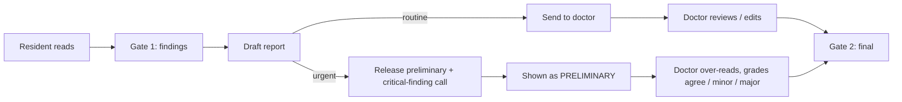
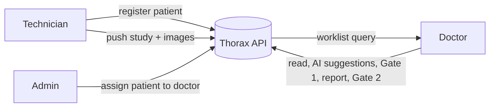

# Thorax AI: clinical workflow review and revised flow

Review date: 23 November 2026. Scope: the task list for this review.
1. How the X-ray technician and the doctor actually work.
2. A revised app flow in which images reach the server the way a PACS receives them, and the doctor simply queries them.
3. A mock database shaped like MIMIC, and the choice of data technology.
4. Organ outlines on the image.
5. Input for the detailed AWS architecture (Đức Anh).

## 1. How a chest X-ray moves through a hospital

Three systems take part:
- The **RIS** (Radiology Information System) holds orders, schedules and report status.
- The **modality** is the X-ray machine and its console.
- The **PACS** (Picture Archiving and Communication System) stores and serves the images, using the DICOM standard.

```mermaid
sequenceDiagram
    participant Clin as Referring clinician
    participant RIS as RIS (orders, status)
    participant Tech as X-ray technician (radiographer)
    participant Mod as X-ray console (modality)
    participant PACS as PACS (DICOM archive)
    participant Doc as Radiologist (reading doctor)
    Clin->>RIS: Order "Chest X-ray PA", with the clinical question
    RIS->>Mod: Modality worklist entry (patient, accession number, procedure)
    Tech->>Mod: Pick the patient from the worklist and check identity and order
    Tech->>Mod: Position the patient (PA erect if possible) and take the images
    Tech->>Mod: Check quality: markers, exposure, inspiration, patient data
    Mod->>PACS: Send the images (DICOM C-STORE)
    Mod->>RIS: Exam completed (MPPS)
    RIS->>Doc: The study appears on the reading worklist, sorted by priority
    Doc->>PACS: Open the study; priors are prefetched for comparison
    Doc->>RIS: Dictate or type the report, then sign it
    RIS->>Clin: Final report available
```

**The technician:**
1. Picks the patient from the worklist, so no identity is typed by hand.
2. Verifies the patient, the order and the procedure.
3. Takes the images.
4. Checks technical quality and that markers and patient data are correct.
5. Sends the images to the PACS.

The technician never writes the report.

**The doctor:**
1. Works from a worklist, sorted by urgency.
2. Opens the study from the PACS, with priors ready for comparison.
3. Reads the images and writes or dictates the report, then signs it.

The doctor never uploads images.

What this means for Thorax AI:
- **Two roles touch a study, in a fixed order.** The technician **pushes** the images; the doctor **queries** and reads them.
- **The study is identified before it reaches the doctor.** It carries an accession number, a study date and the clinical question (the indication).
- **The reading is the annotation.** In commercial chest X-ray AI (Annalise, Lunit, Qure.ai), the doctor reviews the AI's suggestions inside the reading. Training labels come from a separate tool, such as MD.ai or Encord, or from the doctors' own corrections (Rad AI). No product has a separate annotator role in the reading app.

## 2. Thorax AI before and after

| Step | Before | After (this change) |
| --- | --- | --- |
| Register a patient | Admin | **Technician** (admin can too) |
| Add a study and its images | Doctor, for their assigned patients, or admin | **Technician** (admin can too). Doctors no longer upload. |
| Make the study visible to a doctor | Admin assigns the patient to a doctor | Unchanged: admin assigns the patient to the reading doctor |
| Find the study | Doctor's worklist of assigned patients | Unchanged: the doctor queries the worklist |
| Read, AI suggestions, Gate 1, report, Gate 2 | Doctor | Unchanged |
| Separate annotator labeling screen | Annotator role with its own queue | **Turned off** (setting `THORAX_LABELING`, off by default). The doctor's reviewed boxes at Gate 1 are the annotations. The code stays for later training-data export (spec FR-017). |
| Resident pre-read | None | The annotator acts as a **resident**: reads in the doctor's workspace up to a draft, then **Send to doctor**. Only a doctor signs (Gate 2). |
| Emergency (urgent study) | None | The resident may **Release preliminary** at once, logging who was told of a critical finding. A doctor over-reads it later and grades the difference: agree, minor or major. |

### Resident, attending and over-read

In a teaching hospital the resident reads first and the attending radiologist signs. At night or in the emergency department the resident's report goes out as a preliminary so treatment is not delayed, and the attending over-reads it the next morning. Discrepancies are graded, and critical findings are phoned to the treating doctor and the call is recorded (ACR practice parameter on communication of diagnostic imaging findings).





Roles after the change:
- **Technician:** patient register and study intake only. No readings, no reports, no AI.
- **Doctor:** reads assigned patients. No uploads.
- **Admin:** accounts, assignments, AI control and intake.

This matches Đức Anh's specification (`docs/spec.md` §3, where `doctor` and `admin` are the only clinical roles), with the technician added in front for intake.

## 3. Data technology

| Option | What it is | Fit for this project |
| --- | --- | --- |
| **A. Current store** | SQLite for workflow data; image files on the server disk; our own REST API | Already built and tested. Not DICOM, so it only *imitates* a PACS. |
| **B. Orthanc PACS + current store (recommended for the final)** | Orthanc is a free, lightweight PACS. It stores DICOM and offers the DICOMweb standard: STOW-RS to push, QIDO-RS to query, WADO-RS to fetch. SQLite keeps readings, reports and users. | This is exactly the push/query split from section 1, using the real standard. One extra container on the Lightsail server. Needs a small JPEG/PNG-to-DICOM step for the demo images. |
| C. AWS HealthImaging | AWS's managed medical-image store | Not available on our AWS plan (new AWS experience, Free plan), and too expensive for a capstone |
| D. PostgreSQL | A larger relational database | Not needed for one server and a few users (see `docker/DEPLOY.md`) |

**Decision:**
- **Tonight (A):** the push/query flow inside our own API, with the technician pushing and the doctor querying, so the workflow and screens are right now.
- **Before 06/12 (B):** put Orthanc behind the same API. The technician's upload becomes a DICOMweb STOW-RS push, and the viewer fetches through WADO-RS. The screens don't change.

## 4. Mock database shaped like MIMIC

MIMIC-CXR is organised per patient, then per study, then per image:

```text
files/p10/p10000032/s50414267/02aa804e-bde0afdd-112c0b34-7bc16630-4e384014.jpg
      │    │         │         └ dicom_id: one image
      │    │         └ study_id: s + 8 digits (50,000,000–59,999,999)
      │    └ subject_id: p + 8 digits (10,000,000–19,999,999)
      └ group folder: first two digits of subject_id
```

The metadata CSV has one row per image: `dicom_id`, `subject_id`, `study_id`, `ViewPosition` (PA, AP, LATERAL), `Rows`, `Columns`, `StudyDate`, `StudyTime`. Each study also has a free-text report with FINDINGS and IMPRESSION sections.

The mock database copies this structure, not MIMIC's data. MIMIC is restricted and never goes on the demo server. It uses:
- public NIH ChestX-ray14 images and our synthetic images
- made-up patients and reports
- IDs in MIMIC's ranges and the same folder and CSV layout

`scripts/demo_data/mimic_mock.py build` makes the folder and CSVs from a folder of images. It can take the `selection.csv` from `select_nih_demo.py` to carry the NIH finding, age and sex. `mimic_mock.py push` then sends every study through the technician's intake API: register the patient, then push the study. That is the same path a real technician uses, after which an administrator assigns the patients to doctors.

| MIMIC field | Thorax table and column |
| --- | --- |
| `subject_id` | The patient's name in the app (`Mock subject <subject_id>`), so a doctor can search by it; the app still assigns its own `PX-` code |
| `study_id`, `StudyDate` | `studies` (study date); the folder name becomes the accession number |
| `dicom_id`, `ViewPosition`, `Rows`, `Columns` | `images` (view, width, height; the file is stored by hash) |
| `StudyDate`, report INDICATION | `studies.study_date`, `studies.indication` |
| Report FINDINGS / IMPRESSION and `mimic-cxr-2.0.0-chexpert.csv` | Kept in the mock folder as the reference reading. They are not pushed, so the doctor reads blind. |

## 5. Organ outlines on the image

The reference picture outlines the left lung, right lung, heart, spine and trachea. Two points matter:
- **Left and right follow radiology convention.** The patient's right lung appears on the **left** of the image. The reference picture labels them the wrong way round.
- **The data decides which organs can be shown:**

| Source | Organs | Usable on the demo server? |
| --- | --- | --- |
| CheXmask (PhysioNet, open access; check the exact licence before release) | Left lung, right lung and heart as outlines (run-length masks), for NIH, CheXpert, VinDr, PadChest and MIMIC images | Yes for NIH images. Use masks with a mean Dice RCA of 0.7 or more, as the dataset recommends. |
| Chest ImaGenome (the team has it) | 29 anatomical regions as boxes, including trachea, spine area and mediastinum | No: MIMIC only, restricted |
| Our U-Net | Both lungs as one shape | Too coarse for this view |

**Plan:**
1. Draw the CheXmask outlines for the right lung, left lung and heart on NIH demo images, with a toggle in the viewer.
2. Add spine and trachea only if a public source with those labels is found.

## 6. AWS architecture input (for Đức Anh)

The current deployment diagram is at https://claude.ai/artifact/W3TmWLViuGFfjaSkjmNo3X. The revised flow adds:
- The technician's push path: technician browser → HTTPS → API → image store.
- Later, an **Orthanc** container next to the API on the Lightsail server. It is reached only inside Docker; the browser never talks to Orthanc directly.

## 7. Status

| Item | Status |
| --- | --- |
| Workflow review (this document) | Done |
| Technician role (`/intake` page); doctors stop uploading; labeling off by default | Built on `vietanh`. 90 backend tests pass; Playwright passes 6 tests with 2 annotator tests skipped, 2 in mock mode, and the annotator tests with labeling switched on. |
| Resident sign-off and emergency preliminary report | Built on `vietanh` (plan `docs/superpowers/plans/2026-11-23-resident-signoff.md`). Backend tests pass on SQLite and PostgreSQL; Playwright covers both flows. |
| MIMIC-shaped mock database | Built: `scripts/demo_data/mimic_mock.py` (build and push), with a test. Pushed 3 studies into a local API as the technician. |
| Orthanc PACS behind the API | Planned before 06/12 |
| Organ outlines (CheXmask) | Planned before 06/12, after the licence check |

## Sources

- Workflow:
  - [Osmosis, Digital imaging informatics and workflow (Rad Tech)](https://www.osmosis.org/learn/Digital_imaging_informatics_and_workflow:_Rad_Tech)
  - [RCR, integrating AI with RIS and PACS](https://www.rcr.ac.uk/media/hu2f3pn5/rcr-publications_integrating-artificial-intelligence-with-the-radiology-reporting-workflows-ris-and-pacs-_march-2021.pdf)
  - [RCR, quality of chest X-rays audit](https://www.rcr.ac.uk/career-development/audit-quality-improvement/auditlive-radiology/quality-of-chest-x-rays-qsi-ref-xr-503)
  - [Carestream, radiology productivity](https://carestream.com/blog/?p=18428)
  - [RIS/PACS workflow study (PMC)](https://pmc.ncbi.nlm.nih.gov/articles/PMC3045177)
  - [Reading workflow (PMC)](https://pmc.ncbi.nlm.nih.gov/articles/PMC3043948)
- Products:
  - [harrison.ai Annalise CXR](https://harrison.ai/CXR)
  - [Lunit CXR4 brochure](https://www.lunit.io/en/wp-content/uploads/resources/Global_Brochure_CXR4_2025_06_v2%20(1).pdf)
  - [Qure.ai qXR study (PMC)](https://pmc.ncbi.nlm.nih.gov/articles/PMC9689183)
  - [Rad AI FAQ](https://www.radai.com/faq)
  - [MD.ai labeling study (PMC)](https://pmc.ncbi.nlm.nih.gov/articles/PMC7165201)
- PACS: [Orthanc DICOMweb plugin](https://orthanc.uclouvain.be/book/plugins/dicomweb.html), [Orthanc Docker images](https://orthanc.uclouvain.be/book/users/docker-orthancteam.html)
- MIMIC: [MIMIC-CXR on PhysioNet](https://physionet.org/content/mimic-cxr/2.0.0/), [MIMIC-IV CXR module](https://mimic.mit.edu/docs/iv/modules/cxr/), [MIMIC-CXR-JPG](https://physionet.org/content/mimic-cxr-jpg/)
- Organs: [CheXmask on PhysioNet](https://www.physionet.org/content/chexmask-cxr-segmentation-data/1.0.0/), [CheXmask paper](https://arxiv.org/pdf/2307.03293)
