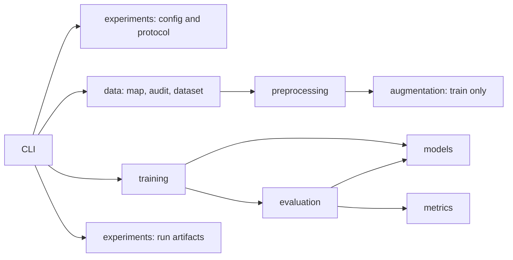

# Research package architecture

This package implements the development paths for MedGemma 1.5 B0/B1 and an exploratory binary anatomical U-Net. It does not implement the app, B2/B3/M1, or a final paper evaluation protocol.

## Ownership

| Package | Owns | Does not own |
| --- | --- | --- |
| `data` | Canonical records, source-column mapping, joins, split audit, datasets, synthetic fixtures | Model loading or optimization |
| `preprocessing` | Deterministic geometry, mask decoding, MedGemma chat processing and label masking | Random policy selection |
| `augmentation` | Train-only paired geometry and image intensity transforms | Validation transforms, split selection |
| `models` | U-Net definition and MedGemma/LoRA loading | Dataset iteration, metrics, run directories |
| `training` | Optimization, training objectives, task-specific resume | Inference benchmark claims |
| `evaluation` | Validation inference and aggregate result production | Optimizer updates or test-set tuning |
| `metrics` | Pure scoring definitions and aggregation | Model loading, data access, file writes |
| `experiments` | Config, protocol checks, run lifecycle, provenance, checkpoint identity, environment checks | Dataset source semantics |
| `utils` | Hashing, atomic I/O, errors, seeds, paths, tensor precision | Manifests, mapping, business or research rules |

Manifest and mapping belong to `data`, even though other packages use them. `utils` only contains operations that have no dataset or model meaning. `training/losses.py` contains differentiable objectives; reported Dice/IoU and VQA scores belong to `metrics`.

## Execution

MedGemma keeps its own processor and chat template. U-Net uses paired letterboxing and mask transforms. Neither applies the other task's preprocessing. No horizontal flip or random crop is exposed.

MedGemma B0/B1 templates load unquantized BF16 base weights via
`medgemma.quantization: "none"`. B1 trains language-only LoRA with FP32 adapters
and BF16 mixed-precision compute; base, vision and projector weights stay frozen.
The explicit `"nf4"` option retains QLoRA for separately recorded profiles.
Model identity includes precision/quantization and rejects mismatched artifacts.
See [the profile and migration notes](../../../configs/README.md#medgemma-bf16-lora-profile).

`UNet` is a `torch.nn.Module`; datasets are PyTorch dataset classes; `VQACollator` owns processor state; `SplitAudit` owns the identity maps; configuration and records use dataclasses. Stateless calculations remain functions. There is no generic base trainer or plugin registry: Hugging Face owns MedGemma optimization, while U-Net uses its own short training loop.

## Extension rules

Add a module to the package that owns its behavior. A new metric should not need a model import. A new model must not introduce a dataset split. A new dataset source must produce the same audited canonical records. Enable a new task explicitly in config validation and CLI dispatch only after its research scope is recorded.

Keep imports explicit and package `__init__.py` files light. Importing the CLI must not initialize PyTorch, Transformers, CUDA or model downloads. `tests/research/test_package.py` enforces dependency boundaries and checks module import cycles.

`data/catalog.py` owns the private SQLite catalog, source fingerprints, aggregate
audits and crosswalk exports. `data/catalog_sources.py` owns release-specific
ingestion, while `data/source_refs.py` reads original CSV/ZIP references.
`catalog` exposes this path through the package CLI. Its intermediate schema is
kept separate from training records. `data/catalog_adapter.py`, exposed as
`prepare-catalog --spec`, converts pinned development QA to canonical schema 3
using explicit policy choices, `SplitAudit` and the canonical manifest loader.
It retains the union test seal and does not create grounding or segmentation
targets. See [the manifest guide](../../../DATA_MANIFESTS.md) for private storage,
specification fields and remaining training gates.

`data/quality.py` owns resumable private QC, with development QA processing in
`data/qa_audit.py` and bounded image/mask checks in `data/image_audit.py`.
`preprocessing/labels.py` owns versioned, meaning-preserving text operations and
lexical review cues. `preprocessing/dicom.py` owns explicit auxiliary DICOM
display conversion; `preprocessing/annotations.py` owns original-coordinate box
and scene-graph parsing. These modules do not select clinical labels, primary
templates or a finding-grounding protocol. See the
[processing guide](../../../DATA_PROCESSING.md).

`experiments/sweep.py` owns YAML variant/seed expansion and sequential process
orchestration. It invokes the normal training CLI in a fresh process for each
run, so model state and CUDA allocations are not shared between experiments.
The existing task-specific trainers and their protocol checks remain the
execution path. Use `sweep --dry-run` to inspect the expanded plan.

`data/shards.py` owns WebDataset tar packing and the local indexed reader.
`data/batching.py` owns finite, seeded length bucketing. The collator pads cached
tokens on CPU; `preprocessing/decoding.py` runs PIL or DALI decoding in the main
process. `training/cached_trainer.py` connects that path to Hugging Face Trainer
after label counting for gradient accumulation. U-Net shares the encoded-byte
loader and has separate paired tensor transforms. The checkpoint's image
processor still owns MedGemma resizing and normalization. See the
[I/O guide](../../../configs/IO_PIPELINE.md) for configuration, cache identity,
GPU checks and storage limits.

## Decision and current limits

Two design candidates were reviewed: task-owned training loops, and a shared generic task engine. The first was selected for the two different model families. Shared config, artifact integrity and run lifecycle were retained from the second. The independent design review preferred the smaller interfaces; this does not substitute for human research review.

The package separation follows the user's requested directory boundaries. `scripts/research` was a temporary prototype and has no remaining Python source or compatibility aliases. `scripts/ci` remains operational tooling.

CPU synthetic tests verify data checks, paired transforms, assistant token masking, U-Net learning and deterministic epoch-boundary resume. They do not verify MedGemma weights, BF16 LoRA/QLoRA CUDA execution, real dataset mapping or clinical performance. GPU training permits H100, H200 or RTX PRO 6000 Blackwell after the normal preflight. RTX 3060/4090 training exceptions remain pending; RTX 5090 is inference-only. Test-set execution is deliberately unavailable until a final evaluation protocol is implemented and locked.

See [the run guide](../../../configs/README.md) for commands and unresolved real-run decisions.
